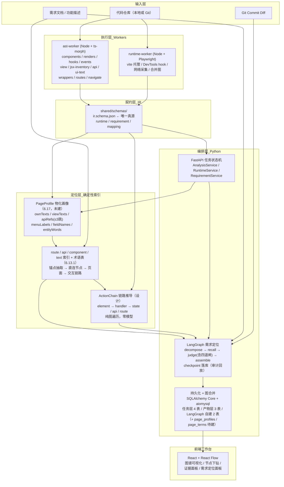

# 前端代码智能分析平台 —— 完整技术方案

> 本文面向技术决策者与后续开发者，**系统回答五个问题**：平台想做什么、选了什么技术、为什么这样选、信息是怎么收集到的、IR 是什么。与 [engineering.md](./engineering.md)（实现硬约束）和 [p3-semantic-layer-design.md](./p3-semantic-layer-design.md)（阶段计划）互补，是最上层的全景文档。

---

## 一、平台想做什么

一句话：

> 输入一份需求文档 / 一段功能描述 / 两个 Git Commit 之间的 Diff，平台结合前端代码仓库，自动定位涉及的**页面、UI 组件、组件属性、事件处理函数、状态管理、接口调用与页面跳转关系**，最终产出一份**可视化、可下钻、带证据链的前端功能链路图**。

两个真实场景对应三种输入模式：

| 场景 | 痛点 | 输入 | 平台输出 |
| --- | --- | --- | --- |
| **改一处不知道影响面** | 组件被谁使用、props 从哪来、接口在哪调用全靠人肉搜索 | 两个 Git Commit 的 Diff | 变更文件 → 受影响组件 → 受影响页面 → 回归测试点 |
| **需求评审前识别测试重点** | 写了需求、改了代码，但没人能说清楚到底影响了哪些 UI 和交互 | 需求文档 + 对应 Diff | 需求功能点 ↔ 代码位置映射 + 可视化链路 + 置信度 |

### 核心立场（三条不能改的设计原则）

1. **静态分析负责确定代码中实际存在的关系，AI 负责理解这些关系的业务含义，Playwright 负责补充实际运行时观察到的行为。**
2. **不编造节点与边。** 静态分析遇到解析不到就记告警，运行时采集不到就跳过，AI 推断永远封顶置信度 0.6。
3. **每条结论必须携带来源、置信度、代码位置。** 禁止输出无法追溯的自由文本结论。

---

## 二、技术选型全景与理由

### 2.1 分层选型表

| 层 | 选型 | 为什么选它 | 为什么不选其他 |
| --- | --- | --- | --- |
| 前端工作台 | React + TypeScript + React Flow | React Flow 是目前最成熟的节点式关系图组件，内置布局、缩放下钻、自定义节点卡片；TypeScript 与后端契约同源生成 | 不用 D3 手写——节点交互、拖拽布局、缩放都是成熟需求，不值得自研 |
| **后端编排** | Python 3.12 + FastAPI | 异步生态成熟（aiomysql / httpx）、LangGraph 原生、与 AI 框架同语言；任务状态机、校验、装配逻辑都是 I/O 密集 | 不用 Node 统一——静态分析 Worker 已经在 Node（ts-morph 必须），但编排层逻辑偏业务与 AI，Python 更顺手；也不用 Go——fastapi 的开发效率对单人项目够用 |
| **静态分析 Worker** | Node.js + ts-morph | **这是整个方案的核心依赖选择**。ts-morph 是 TypeScript Compiler API 的轻封装，可以直接复用项目的 `tsconfig.json`、`paths` 别名、`baseUrl`，做到**和 tsc 编译语义完全一致**的解析 | 不用 Babel / ESLint 解析器——它们是 syntactic 工具，不理解 TS 符号解析（tsconfig.paths、barrel 穿透、类型归属全丢失）；不用独立写一个解析器——TypeScript Compiler API 已经是最完备的 JS/TS 前端语义分析器 |
| **运行时 Worker** | Node.js + Playwright | Playwright 的 trace viewer 已经证明了其采集能力（操作记录 + DOM 快照 + 网络日志）；与 ast-worker 同语言减少跨语言序列化问题；React DevTools hook 只能在 JS 上下文里调用 | 不用 Python Playwright——可行但 React DevTools 注入脚本写起来别扭，且同语言有复用价值 |
| **持久化** | SQLAlchemy 2.0 Core（仅 Core，不用 ORM）+ aiomysql | SQLAlchemy Core 提供足够的 SQL 构造与结果映射但免去 ORM 开销；表少、查询简单，ORM 的状态跟踪在这里是纯开销。aiomysql 是纯 Python 异步驱动，与 FastAPI 的 async 栈一致 | 不用 ORM——没有对象图遍历需求，产物整包存 JSON；不用 alembic——只加列不改列、启动时幂等建表/补列已足够 |
| **AI 编排** | LangGraph + AIOMySQLSaver | 需求定位是多节点图（decompose → recall → judge → assemble），天然适合 LangGraph 的 StateGraph；节点级 checkpoint 把每一步的输入输出落进 MySQL，回答「模型为什么给出这个结论」 | 不用单轮 prompt + 结构化输出——候选集大时容易截断、无中间状态可回放、成本不可控 |
| **LLM 调用** | OpenAI 兼容协议（httpx + response_format） | 接入各家兼容 OpenAI 协议的服务只需改配置；结构化输出由 `response_format` 约束到 JSON Schema | 不用 LangChain Agent——太重，只需要结构化输出和节点间状态传递；不用各家 SDK——统一协议让换模型只改一个配置项 |
| **跨层契约** | JSON Schema → 代码生成 | `shared/schemas/*.json` 是唯一真源，`datamodel-codegen` 产 Python 类型、`json2ts` 产 TS 类型，禁止手写同名定义 | 不用 Protobuf——schema 迭代频率高，JSON 更直观；不用 OpenAPI——只覆盖 HTTP 边界，Worker 内部协议也要管 |

### 2.2 一个关键架构决策：为什么 Worker 分离

静态分析必须用 Node（ts-morph），运行时采集也用 Node（Playwright + React DevTools hook）。后端编排用 Python。三者之间**严格通过 JSON Schema 交换数据，不做进程内耦合**。

```
┌─────────────────────────────────────────────────────────────┐
│ Python FastAPI 编排层                                       │
│ 任务状态机 · 持久化 · 图合并 · AI 编排 · API                 │
└─────────┬──────────────────────────┬───────────────────────┘
          │ stdin/stdout JSON        │ stdin/stdout JSON
          ▼                          ▼
┌──────────────────┐     ┌──────────────────────────┐
│ ast-worker (Node) │     │ runtime-worker (Node)    │
│ ts-morph          │     │ Playwright               │
│ AST → IRGraph     │     │ DevTools hook → runtime  │
└──────────────────┘     └──────────────────────────┘
          │                          │
          ▼                          ▼
   shared/schemas/ir.schema.json    shared/schemas/runtime.schema.json
```

**不分离的代价**：如果把 ts-morph 放进 Python 子进程调用，tsconfig 解析、paths 别名、barrel 穿透这些依赖 Node 生态的东西会变成噩梦；如果把 Playwright 放进 Python 编排层但 React DevTools 注入脚本仍然要写 JS，跨语言序列化复杂度指数上升。**进程边界反而让每条链路都可以独立测试、独立替换、独立崩溃不拖垮编排层**。

---

## 三、IR 到底是什么

IR（Intermediate Representation，中间表示）是本平台最核心的数据结构。它是**所有分析器、运行时采集、AI 推断层、数据库表、API 响应、前端图渲染之间唯一的共同语言**。

### 3.1 为什么需要 IR

直接让 LLM 读代码、直接让前端从 Playwright trace 里渲染图、直接让后端从 ts-morph AST 里查组件——这些方案在各做各的时都能工作，但一旦要**把不同来源的信息合并、叠加置信度、让前端统一展示**，就会爆炸。IR 做的事情是：

> 把所有来源的前端分析结果，统一成一套「节点 + 边 + 证据」的图结构，不管这个节点是静态分析扫出来的还是运行时采集到的还是 AI 推断出来的。

### 3.2 IR 长什么样

```json
{
  "version": "1.0",
  "analysisId": "ana_abc123",
  "nodes": [
    {
      "id": "src/pages/UserList.tsx#UserList",
      "kind": "component",
      "name": "UserList",
      "file": "src/pages/UserList.tsx",
      "loc": { "line": 15, "col": 3 },
      "attrs": {
        "uiText": ["用户列表", "搜索", "状态"],
        "hooks": ["useEffect", "useState"],
        "props": [
          { "name": "onRefresh", "type": "() => void", "optional": false }
        ]
      },
      "evidence": [
        { "source": "static", "confidence": 1.0, "file": "src/pages/UserList.tsx", "loc": {"line": 15, "col": 3} },
        { "source": "runtime", "confidence": 0.9, "traceId": "trc_xyz789" }
      ]
    }
  ],
  "edges": [
    {
      "id": "src/pages/UserList.tsx#UserList→src/components/Table.tsx#Table:renders",
      "from": "src/pages/UserList.tsx#UserList",
      "to": "src/components/Table.tsx#Table",
      "kind": "renders",
      "evidence": [
        { "source": "static", "confidence": 1.0, "file": "src/pages/UserList.tsx", "loc": {"line": 32, "col": 11} }
      ]
    }
  ],
  "warnings": [
    { "code": "unresolved_import", "severity": "warning", "stage": "static",
      "file": "src/pages/UserList.tsx", "message": "import './styles.css' 解析不到" }
  ]
}
```

### 3.3 受控枚举（NodeKind / EdgeKind）

**NodeKind**：节点类型是受控枚举，新增必须升级 schema 版本。

| 类型 | 说明 | 典型来源 | 关键 attrs |
| --- | --- | --- | --- |
| `component` | React 组件（页面组件 + UI 组件） | 静态 / 运行时 | `props` / `uiText` / `wrapper` / `external` |
| `element` | 有语义的 JSX 元素（控件 / 容器 / 链接 / 文本） | 静态（view / events） | `tag` / `target` / `viewRole` / `viewText` / `columns` / `events` |
| `hook` | 自定义或基础 Hook（`useEffect`、`useCustom`） | 静态 | `hookName` / `custom` / `deps` / `binding` |
| `state` | `useState` 产出的状态 | 静态 | `setter` / `typeText` / `initial` |
| `fn` | 处在请求链路上的模块级函数（`fetchUsers`） | 静态 | `role` |
| `api` | 实际的 HTTP 请求（URL + method） | 静态 / 运行时 | `method` / `url` |
| `route` | 路由路径（`/users`） | 静态 | `path` / `params` / `framework` / `index` |
| `server-component` / `server-action` | Next.js RSC 专用 | 静态 | — |

> `element` 不是「所有 JSX 标签」。收进来的是**有语义的**元素：控件（`<button>` / `<Select>`）、链接、语义容器、文本标签、带字面量 `columns` 的表格、带可见文案的元素。`div` / `span` 这类布局噪声默认不入图，否则一个页面会产生几百个节点。详见 4.1.4。

**EdgeKind**：边的类型。

| 类型 | 说明 | 例子 |
| --- | --- | --- |
| `renders` | 组件渲染了子组件；route 渲染了页面组件 | UserList → Table；`/users` → UserList |
| `contains` | 视图层级：组件 / 元素包含子元素 | UserList → `<Table>`；`<Table>` → `<Button>` |
| `calls` | 函数调用了另一个函数 | UserList → fetchUsers |
| `reads` | 组件读了某个状态 | UserList → useState(loading) |
| `writes` | 组件写了某个状态 | UserList → setLoading |
| `requests` | 组件 / 函数发了 HTTP 请求 | UserList → GET /api/users |
| `uses` | 组件使用了某个 Hook / 元素 | UserList → useEffect；UserList → `<Button>` |
| `navigates` | 跳转到某个 route 节点 | `<Link to="/users">` → `/users` |
| `boundary` | client / server 组件边界（Next.js RSC） | — |

> `contains` 与 `navigates` 现在都有产出者：`view.ts` 产 `contains`（组件 / 元素 → 子元素），`navigate.ts` 产 `navigates`（`<Link to>` / `<Navigate to>` / `navigate()` / `router.push()` / `redirect()` → route 节点）。识别口径建立在「包来源 + 符号回溯」上，不看名字猜：`useNavigate` 必须来自路由包，`navigate` 变量必须是它的返回值，项目自造的同名函数不算。目标路径是字面量时 0.9，含模板插值时 0.8；路径定不下来或路由表里没对应节点时只告警，不编造边。

### 3.4 证据链机制（Evidence）

每个节点和边都必须携带至少一条 `evidence`，包含：

```json
{
  "source": "static | runtime | ai",
  "confidence": 0.0 ~ 1.0,
  "file": "相对路径（静态证据）",
  "loc": { "line": 15, "col": 3 },
  "traceId": "运行时采集记录 ID（运行时证据）"
}
```

**置信度取值规则**（这是整个方案最核心的设计约束之一）：

| 来源 | 置信度 | 说明 |
| --- | --- | --- |
| 静态·语法事实 | 1.0 | 组件定义位置、JSX 标签本身、`path="/users"` 字面量——直接写在源码里，没有歧义 |
| 静态·符号推断 | 0.8 ~ 0.9 | 结论正确性依赖符号解析的完整度：经请求封装器传递的 URL 0.9、经局部变量的 URL 0.8、事件处理函数解析 0.9、`route → 页面组件` 0.9 |
| 运行时（双证） | 0.9 | 文件路径 + 组件名都对上了静态节点 |
| 运行时（单证） | 0.7 ~ 0.8 | 只对上文件或只对上组件名 |
| AI 推断 | **封顶 0.6** | AI 匹配候选集后给出的映射结论，服务端硬封顶 |

**"静态分析恒为 1.0"是一个容易被误读的说法**（这张表里就不成立，见「静态·符号推断」一档）。它只适用于「语法事实」这一档。`<Table />` 确实渲染了 Table 是 1.0；但「`request({ url })` 经三层封装后对应 `GET /api/users`」是符号推断，实现里给 0.9 或 0.8。把两者混成 1.0 会让使用者把推断当事实信任。IR 里这两档的区别体现在同一 `Evidence.confidence` 字段的取值上，前端按数值分档着色。

同一原则也适用于视图层：`<button>` 确实是按钮（结构 1.0），但「这个子元素属于哪个视图父节点」要跨过被丢弃的布局层，给 0.9；`<Link to="/users/42">` 匹配到 `/users/:userId` 需要按段推断动态路由，给 0.8。

**这个字段只回答一个问题：「这个结论有多确定」**。它不回答「这个节点覆盖了多少内容」。第三方组件的内部结构不可见，是覆盖范围问题，用 `attrs.visibility` 表达（见 4.1.3 第 5 条）；`0.6` 这一档保留给 AI 推断，不允许被其他语义复用。同理，`confidence` 也不表达「重要程度」——重要性用排序和推荐位表达，不要往这个字段里塞。

为什么要这样设计？**因为我们不允许 AI 幻觉覆盖代码事实**。如果你看到一个节点 `confidence=0.6 source=ai` 和另一个节点 `confidence=1.0 source=static`，你立刻知道：后者是代码里真的有，前者是 AI 认为的。这让用户可以放心地把平台输出当成代码事实参考，而不是又让一个 LLM 胡说八道。

### 3.5 告警而非静默降级

分析过程中任何失败都进 `IRGraph.warnings`，前端 `WarningsBanner` 按 severity 排序展示。

```json
{
  "code": "parse_error", "severity": "error", "stage": "static",
  "file": "src/broken.tsx", "message": "TS1005: ';' expected"
}
```

**为什么这是硬约束？** 静默降级会让用户以为某个页面没有组件——实际上是这个文件解析失败了。可追溯的告警让平台输出可审阅、可审计。

### 3.6 统一契约生成链路

```
shared/schemas/*.schema.json          # 唯一真源（5 份：ir / runtime / requirement / mapping / plugin）
        │
        ├── datamodel-codegen ──> backend/app/contracts/*.py   # Python 类型
        │
        └── json2ts ───────────> shared/contracts/src/*.ts    # TS 类型
                                        │
                                        └──> workers/* / frontend 通过 @uicodeanalysis/contracts 引用
```

**禁止手写同名类型定义**。改字段、加枚举值、升版本号——第一步永远是改 schema，然后 `npm run gen:contracts` 重新生成两侧代码，跑一次 typecheck 验证没有漂移。

---

## 四、UI 组件 & 逻辑信息是怎么收集到的

这部分是整个平台最硬核的工程实现。分两条独立链路：**静态分析**（ast-worker）和**运行时采集**（runtime-worker），最终汇入统一 IR。

### 4.1 静态分析链路（ast-worker）

#### 4.1.1 底层技术选型：为什么是 ts-morph（不是 Babel / ESLint / acorn）

这是整个平台最核心的技术选型决定。**ts-morph 是 TypeScript Compiler API 的薄封装**，它让我们可以复用项目自带的 `tsconfig.json`，得到和 tsc 编译器**完全一致**的模块解析与类型系统结果。其他所有解析器（Babel、ESLint、acorn、recast）都是 syntactic 工具，只回答"这段代码长什么样"，不回答"这段代码在项目里是什么意思"。

下面用**四个真实代码场景**对比 ts-morph 和其他解析器的区别，每个场景都直接对应 ast-worker 的实现逻辑：

##### 场景 1：tsconfig 路径别名

项目 `tsconfig.json`：

```jsonc
{ "compilerOptions": { "paths": { "@/*": ["src/*"] } } }
```

`src/pages/UserList.tsx`：

```tsx
import { Table } from '@/components/Table';
```

**ts-morph 怎么做**（[`workers/ast-worker/src/resolver.ts`](workers/ast-worker/src/resolver.ts)）：直接调用 `imp.getModuleSpecifierSourceFile()`——这是 TypeScript Compiler 在内部已经完成模块解析后的结果，返回值就是 `src/components/Table.tsx` 的 SourceFile 对象。**和 `tsc --noEmit` 的报错完全一致**。

**Babel / ESLint / acorn 怎么做**：它们完全不知道 tsconfig 里有 paths。你要么写一个 glob 匹配器自己实现一遍别名解析（要处理 baseUrl、extends、monorepo 多 tsconfig、大小写敏感），要么放弃、只按裸字符串 `@/components/Table` 处理。**自己实现的路径解析器迟早会和 TypeScript 编译器语义分叉**——比如项目后来加了 `extends: './tsconfig.base.json'`，TypeScript 会正确继承 paths，而你手写的 glob 不会。

##### 场景 2：barrel 穿透 + 导出合并

`src/components/index.ts`（barrel）：

```ts
export * from './Table';
export { default as TableCard } from './TableCard';
```

`src/components/Table.tsx`（实际定义）：

```tsx
export function Table({ ... }) { return <div>...</div>; }
export default function TableDefault() { return <Table />; }
```

**ts-morph 怎么做**（[`workers/ast-worker/src/components.ts`](workers/ast-worker/src/components.ts)）：

```ts
const exported = file.getExportedDeclarations();
for (const [exportName, decls] of exported) {
  for (const decl of decls) {
    if (decl.getSourceFile() !== file) continue;  // 只保留定义在本文件的
    // Table.tsx 会被遍历到两次 exportName（Table 和 default），
    // 但 decl 指向同一个 AST 节点，合并成一个组件 id
  }
}
```

`getExportedDeclarations()` 会自动沿 `export *` 穿透到最终定义位置。`Table.tsx` 里的 `Table` 会同时出现在 `Table.tsx` 和 `index.ts` 的导出表里——但我们只保留 `decl.getSourceFile() === file` 的条目，组件便只在**定义处**产出一次。而 `Table` 的具名导出和 default 导出指向同一个 AST 节点，按定义位置合并后还是一个组件。

**Babel / ESLint / acorn 怎么做**：它们只告诉你这个文件有 `export * from './Table'` 这条语句。你需要自己写一个 barrel 穿透解析器——要处理 re-export、default re-export、re-export as namespace、循环 barrel 引用…… TypeScript Compiler 已经做过的事情，你又重写一遍，而且大概率写错。

##### 场景 3：三态模块解析（internal / external / unresolved）

`src/utils/request.ts`：

```ts
import axios from 'axios';          // 裸包名
import { hook } from './useFetch';  // 相对路径
import { foo } from '@/broken';     // 别名但指向不存在的文件
```

**ts-morph 怎么做**（[`workers/ast-worker/src/resolver.ts`](workers/ast-worker/src/resolver.ts)）：

```ts
function resolveOne(fromFile, specifier): Resolution {
  const target = findTargetSourceFile(fromFile, specifier);
  if (target) {
    if (isProjectSource(rootPath, target.filePath))
      return { status: "internal", filePath: target.filePath };    // axios 没装 → 不存在这条
    return { status: "external", packageName: specifier };
  }
  return { status: "unresolved", isLocal: isLocalSpecifier(specifier) };
  // './useFetch' 和 '@/broken' 都是 unresolved，但前者是本地相对路径（真实断链），
  // 后者 @/ 是别名前缀（也是本地），axios 是裸包名（环境问题）
}
```

解析不到的两种情况**必须区分**：相对路径/别名前缀解析不到是代码真实缺陷（`unresolved_import` error 告警），裸包名解析不到是依赖没装（`dependency_not_installed` info 告警）。把两者混为一谈会让"依赖没装"淹没"代码写错"。

**Babel / ESLint / acorn 怎么做**：完全做不到三态。它们不知道 `node_modules` 装了什么、`tsconfig` 别名是什么——你只能把所有解析失败的 import 当成同一种情况。

##### 场景 4：组件判定看结构不看名字

普通函数 vs 自定义 Hook vs React 组件：

```tsx
const formatDate = (d) => d.toISOString();              // 普通函数
const useUserData = () => useState(null);                // 自定义 Hook
const UserList = ({ users }) => <List>{users}</List>;   // React 组件
```

**ts-morph 怎么做**（[`workers/ast-worker/src/components.ts`](workers/ast-worker/src/components.ts)）：

```ts
function looksLikeComponent(node: Node): boolean {
  const hasJsx = node.getDescendants().some(d => JSX_KINDS.has(d.getKind()));
  if (hasJsx) return true;
  const returnTypeText = node.getType().getCallSignatures()
    .map(sig => sig.getReturnType().getText()).join("|");
  return /JSX\.Element|ReactElement/.test(returnTypeText);
}
```

判定依据是**体内有没有 JSX 节点**（不依赖 `@types/react` 是否安装）和**返回类型是不是 JSX.Element**。`formatDate` 里没有 JSX、返回 `string`；`useUserData` 里没有 JSX、返回是 `[T, SetState<T>]` tuple；`UserList` 里有 `<List>` JSX 节点。**零名字推断**——不会因为函数名以 `use` 开头就当 Hook，不会因为大写开头就当组件。

**Babel / ESLint / acorn 怎么做**：它们只能拿到函数体的 AST。用 Babel 遍历器也能找 JSX 节点，但**类型检查完全缺失**——`getType()`、`getCallSignatures()`、`Node.isFunctionDeclaration()` 这些都没有。

##### 对比汇总

| 能力 | ts-morph | Babel | ESLint | acorn |
| --- | :---: | :---: | :---: | :---: |
| 复用 tsconfig paths 别名 | ✅ | ❌ | ❌ | ❌ |
| barrel 自动穿透到最终定义 | ✅ | ❌ | ❌ | ❌ |
| 区分 internal / external / unresolved | ✅ | ❌ | ❌ | ❌ |
| 三态 unresolved（本地断链 vs 依赖未装） | ✅ | ❌ | ❌ | ❌ |
| 类型系统查询（返回类型、泛型参数） | ✅ | ❌ | ❌ | ❌ |
| 符号引用查找（谁引用了这个 useState） | ✅ | ❌ | ❌ | ❌ |
| 项目级 SourceFile 索引 | ✅ | ❌ | ❌ | ❌ |
| 成熟度 | TypeScript 官方 Compiler 的薄封装 | 插件生态丰富 | AST traversal 好 | 最快解析器 |
| 可调试性 | 继承 tsc 的错误信息 | 自实现 parser，错误信息一般 | 自实现 | 自实现 |

**ts-morph 的唯一缺点**：启动慢（首次加载 `ts.Program` 会构建整个项目的类型信息，~90ms/文件）。解决方式是复用——同一个 `Project` 实例在单次分析内复用，后续 `getExportedDeclarations()` 调用就变成 ~1ms/次，复用率提升了约 90 倍。这已经在 ast-worker 里固化为硬约束（见 engineering.md）。

#### 4.1.2 分析器模块清单（每个做什么）

| 模块 | 产出 | 方法 |
| --- | --- | --- |
| **components.ts** | `component` 节点 | 函数体内是否出现 JSX 节点（不依赖 `@types/react` 是否安装）；返回类型是否是 `JSX.Element`；不看函数名（避免把普通函数当组件或把自定义 hook 误判） |
| **paths.ts + resolver.ts** | 模块解析三态 | 消费 ts-morph 的 `getModuleSpecifierSourceFile()`，区分 internal / external / unresolved；自己不实现 paths 匹配 |
| **renders.ts** | `renders` 边 | 遍历 JSX 开标签，排除首字母小写的 DOM 元素（`<div>`），解析点号标签的最后一段（`Antd.Button` → `Button`），按「定义位置键」（file + charOffset）反查目标组件 |
| **props.ts** | 组件节点 `attrs.props` | 可选性只认问号（`a?: T` vs `a: T \| undefined` 是两件事）；类型文本取源码里的类型节点不取类型系统（保留 `UserRowProps[]` 而不展开成 `{ userId: string; ... }[]`）；默认值只能从解构读（类型系统不记录默认值） |
| **hooks.ts** | `hook` / `state` 节点 + `reads` / `writes` 边 | `useState` 单独算 state 节点，其余算 hook；归属只看组件函数体顶层（穿过函数就停，符合 React 规则）；reads/writes 靠符号引用贯穿全部嵌套层级（`setLoading` 写在 effect 里仍然是本组件写自己的状态） |
| **jsx-inventory.ts** | 全项目统一的 JSX 元素清单 | 一次扫描给每个 JSX 开标签分配稳定 id（`文件 + 字符偏移`），登记归属组件、父标签、标签名/目标名、loc；`view.ts` 与 `events.ts` 查同一份清单，避免两套元素 id 漂移 |
| **events.ts** | `element` 节点 + `attrs.events` | 只认 `on[A-Z]`（React 语言级约定）；宿主元素（`<div onClick>`）和组件回调 prop（`<RowItem onClick>`）同等对待；内联处理函数下探全部嵌套层级（闭包回调里的 setter 也算）；处理函数按「本文件函数表 → state setter → props 回调（注入）」三段落位 |
| **view.ts** | `element` 节点 + `contains` 边 + `viewRole` / `viewText` / `columns` | 只收语义元素（控件 / 链接 / 容器 / 文本 / 表格），布局 `div` 默认丢弃；`viewRole` 由标签 + 属性 + 位置的确定性规则判定；表格列名只认同一文件、单一字面量数组、每项含 `title` 的对象字面量；`contains` 从最近保留祖先连边，跳过被丢弃的布局层 |
| **navigate.ts** | `navigates` 边（元素 / 组件 → `route` 节点） | 受控路由包 + 符号回溯：`useNavigate()` / `useRouter()` 的返回值必须回溯到路由包，`redirect()` 必须来自路由包；识别 `<Link to>` / `<Link href>` / `<Navigate to>` / `navigate()` / `router.push|replace()`。字面量路径精确匹配（0.9），模板插值按段匹配动态路由（0.8）；`<Link>` 的边从元素出发、声明式跳转与函数调用从组件出发；路径定不下来或路由表无对应节点时只告警 |
| **api.ts** | `api` 节点 + `requests` 边 | HTTP 客户端靠「名字 + 符号来源」双重判定（`fetch` + 声明在项目外才是浏览器 fetch，项目里自己写的 `fetch` 不算）；封装器不产 api 节点（URL 定不下来），只登记参数位置；多层封装器识别做不动点循环；置信度三档（URL 字面量 1.0 → 经封装器 0.9 → 经局部变量 0.8） |
| **ui-text.ts** | 组件节点 `attrs.uiText` | 只认枚举来源（JSX 文本 / 白名单属性 placeholder,title,label / 对象字面量的 title,label / i18n 取词键）；`array` 来源额外收紧（含中文或空格或首字母大写，避免把配置表 `["px","rem","em"]` 灌进来）；组件外常量只记告警不猜归属 |
| **wrappers.ts** | 二次封装语义注解 `attrs.wrapper` | 不新增节点与边——renders 分析器已经产出了 `ProTable → Table` 的渲染边；映射只做语义注解（ProTable 就是 antd.Table 的二次封装，props 怎么改名）；所有映射规则来自项目根目录 `mapping.json`，核心分析器零硬编码 |
| **routes.ts** | `route` 节点 + `renders` 边 | 受控路由 API（`react-router-dom` / `createBrowserRouter([{path,element}])` / `<Route path element>` / hash router）+ Next.js 文件约定；动态 path 记告警不编造；产出 `routeId → 页面组件` 的映射，供需求召回的 `routePath` 信号使用 |

**分析顺序**（`index.ts` 的固定流水线，后一步只能消费前一步的事实）：

```
project.ts（构建一次 ts.Program）
  → components.ts（组件定义 + definitionIndex）
  → props.ts / renders.ts / hooks.ts / api.ts（结构层）
  → jsx-inventory.ts（统一元素 id）
  → events.ts（行为层）→ view.ts（视图层，为事件层已收的元素补 contains 父边）
  → ui-text.ts / wrappers.ts（语义标注）
  → routes.ts（页面身份）→ navigate.ts（页面间可达关系）
  → ir-builder（去重、合并 attrs、产 IRGraph + warnings）
```

> 元素之所以先建统一清单再分别分析，是因为「视图层级」和「事件归属」必须指向同一个元素。两个分析器各自遍历 JSX 会得到两套 id，后面前端点击一个按钮时无法同时拿到它的位置、文案和事件。这是 4.1.4、4.1.5 成立的前提。
>
> 两层收的集合不同：事件层收「有点击」的元素（包含 `<div onClick>` 这类布局元素），视图层收「有语义」的元素。交集元素由 `buildGraph` 按 id 合并 attrs，最终节点同时带 `events` 与 `viewRole`。**事件层独有的元素**通过 `extraElementIds` 交给视图层补 `contains` 父边——它们已经是图上的节点，不挂父边就成了视图树里的孤儿，下钻时会断掉。
>
> `navigate.ts` 排在 `routes.ts` 之后：边的目标是 route 节点，且 `<Link>` 的起点要在元素清单里存在（视图层 / 事件层已产出），否则降级为从组件出发并告警。

#### 4.1.3 静态分析的几条硬规则（engineering.md 已固化）

1. **节点 id 必须是 `文件路径 + 组件名` 组合**，同一文件多组件不得冲突（`src/Table.tsx#Table` / `src/Table.tsx#Row`）。
2. **不自己实现 paths 匹配**。tsconfig 里写什么，ts-morph 按什么解析，我们只消费结果。
3. **renders 边只连组件，不连宿主元素**。不产 `<div>` 节点，首字母小写的标签按 JSX 编译语义就是 DOM 元素。
4. **同一 (from → to) 只产一条边**。列表里 10 个 `<RowItem />` 是同一个结构事实。
5. **外部组件进图但明确标注不可见**。`antd#Table` 是薄节点，`attrs.external = true`，不带 file/loc。它的内部结构不在静态分析范围内——不要为了"图更完整"而编造子节点。

   **注意：不可见不等于不确定，不要用置信度表达这件事。** `import { Table } from "antd"` 这条语句本身是语法事实（1.0 档），"内部结构看不到"是**覆盖范围**问题，不是**结论可信度**问题。因此薄节点的 confidence 仍是 1.0，另用 `attrs.visibility = "opaque"` 表达"此节点到此为止"。用 0.6 表示会与 3.4 的「AI 推断封顶 0.6」撞档——前端按数值分档着色时，会把"第三方组件"和"AI 猜的"渲染成同一个颜色。**0.6 这一档只属于 AI。**

#### 4.1.4 每种节点/元素到底提取了什么（逐类清单）

组件元素的信息分三层，全部是确定性提取，**AI 不参与**：

1. **结构事实**：有哪些元素、谁包含谁、在哪个文件哪一行；
2. **语义标注**：元素的角色（控件/容器/文本/链接）、可见文案、表格列、props 描述；
3. **行为事实**：元素上绑了什么事件、事件落到哪个函数、函数读写哪个状态、请求哪个接口。

| 节点 | 识别入口（只认语法 / 语言级 / 生态级约定） | 产出字段 | 产出的边 | 置信度 | 明确不做 |
| --- | --- | --- | --- | --- | --- |
| `component` | `getExportedDeclarations()`；只保留**定义在本文件**的声明；函数 / 类 / 箭头函数且体内含 JSX，或返回类型是 `JSX.Element` / `ReactElement`。不看函数名 | `file` / `loc` / `attrs.props` / `attrs.uiText` / `attrs.wrapper` / `attrs.external` | `renders` / `contains` / `uses` / `calls` / `requests` | 1.0（语法事实） | 不解包 `lazy()`；不识别 HOC 返回的增强组件；不做跨文件求值 |
| `element` | `jsx-inventory` 统一分配 id（`文件 + 字符偏移`）；`view.ts` 的 `decideInclude` 决定是否入图 | `tag` / `target` / `viewRole` / `viewText` / `viewTextDynamic` / `columns` / `attrs.events` | `contains` / `uses` / `calls` / `writes` | 结构 1.0；跨过被丢弃布局层的 `contains` 0.9 | 不收全量 `div` / `span`；不在视图层重复组件实例；不推断动态文案 |
| `hook` | 组件函数体**顶层**的 Hook 调用；`use[A-Z]` 或来自 `react` | `hookName` / `custom` / `deps` / `binding` | `uses`（组件 → hook） | 1.0 | 不进入嵌套函数；不展开自定义 Hook 内部（只到调用点） |
| `state` | 顶层 `useState` 调用 + 数组解构 | `setter` / `typeText` / `initial` | `reads` / `writes` | 1.0（调用）；0.9（引用） | 非解构写法不产 state；不解析 `useReducer` 的 action 语义 |
| `fn` | 只收录**处在请求链路上**的模块级函数：函数体内直接或间接调用 HTTP 客户端 | `role = request_chain` | `calls` / `requests` | 1.0 | 不为任意工具函数建节点；不解析 `obj.method()` 的接收者语义 |
| `api` | 双重判定：符号名（`fetch` / `axios` / `api`）+ 符号来源在项目外；封装器按 `mapping.json` 做不动点穿透 | `method` / `url` | `requests` | 字面量 1.0；经封装器 0.9；经局部变量 0.8 | 不做运行时 baseURL 拼接；不解析 GraphQL；URL 来自函数返回值 / 跨模块常量时只告警 |
| `route` | 受控 API 名单：`createBrowserRouter` 配置对象、`<Route path element>`、`createHashRouter`；Next 项目按 `app/**/page.tsx`、`pages/**/*.tsx` 文件约定 | `path` / `params` / `framework` / `index` / `title` / `pageComponentId` / `layoutComponentIds` | `renders`（route → 页面组件 / 布局组件） | 节点 1.0；页面归属 0.9 | 动态 path 只告警；不猜约定式路由（Next 除外）；layout / page 按 `<Outlet>` / 嵌套路由层级区分（见 4.1.6）；菜单配置提取（`menuFiles` 白名单）仍待做 |
| `props` | 组件第一个参数的类型节点；解构默认值；JSDoc 首行 | `name` / `type` / `optional` / `defaultValue` / `description` / `file` / `loc` | 不产边 | 1.0 | 不展开命名类型别名；不展开泛型实例；不取运行时默认值 |
| `uiText` | 六种来源：JSX 文本 / 白名单属性 `placeholder,title,label` / 对象字面量的 `title,label` / i18n 取词键 / 数组收紧 / 动态标记 | `texts[{text,kind,via,loc}]` / `dynamic` / `truncated` | 不产边 | 1.0 | 不跨文件求值；不翻译 i18n；不猜组件外常量的归属 |
| `wrapper` | 项目根 `mapping.json` 显式声明 | `attrs.wrapper`（底层组件、props 改名、折叠默认值） | 不新增边（renders 已表达） | 1.0（配置事实） | 核心分析器不硬编码任何业务组件名 |

几个容易混淆的点：

- **`uiText` 与 `viewText` 不是同一份数据**。`uiText` 是组件级聚合，用于需求召回；`viewText` 挂在具体元素上，用于「定位到页面后，继续定位到哪个按钮/哪一列」。两者都来自语法，但粒度不同。
- **`columns` 是表格的结构事实**，也是需求里最常引用的界面信息（「列表展示用户 ID、状态、创建时间」）。只认同一文件、单一字面量数组、每项是对象字面量、`title/label/header` 为字面量；`columns={cols}`、`columns.map(...)`、二次加工一律不猜。
- **`element` 的收录边界**：`view.ts` 只收语义元素。判据优先级是「宿主标签名单 → 生态级通用 UI 组件名 → 有字面量 `columns` → 有可见文案」。业务封装组件名（`ProTable` / `BizTable`）不在名单里，靠 `mapping.json` 声明，避免把一个项目的业务名写进核心分析器。
- **两个分析器共用一个元素清单**：`jsx-inventory.ts` 为每个 JSX 开标签分配一次 id（`组件 id + jsx:标签 + 序号`），`view.ts` 与 `events.ts` 都查表。序号按「全部元素」计数，与某元素最终是否被收录无关——否则加一个带事件的按钮就会让后面所有按钮的 id 漂移。这条约束集中在一个文件里，任何一方改动遍历顺序都会让另一方断链。

#### 4.1.5 交互逻辑是怎么还原的

交互逻辑不是 AI「读代码总结」出来的，而是由三类事实拼出来的确定性子图：

```
element（有 viewText / columns / tag）
  ├─ calls ──► fn / hook ──requests──► api
  ├─ writes ─► state
  └─ calls ──► props 回调（父组件注入，链路在本组件终止）
```

**第一步：收事件绑定。** 只认 `on[A-Z]` 属性（React 语言级约定），宿主元素与组件回调 prop 同等对待。一个元素可以绑多个事件，每个事件单独一条 `calls` / `writes` 边。

**第二步：把处理函数落到图上已有的节点。** 顺序固定，不猜：

1. 本文件函数名表（`handleSearch` / `fetchUsers`）；
2. 本组件 state setter（`setKeyword` → `writes`）；
3. 组件 props 字段（`<RowItem onSelect={onSelect}>`）→ 记为**父组件注入**，不继续往子组件里展开；
4. 内联箭头函数：下探函数体，收集其中的 setter 写入、函数调用、HTTP 请求；嵌套闭包同样下探。

**第三步：沿请求链补全接口。** `handleSearch → fetchUsers → GET /api/users` 这条链由 `calls` + `requests` 边天然串起来；封装器穿透后置信度按 1.0 / 0.9 / 0.8 三档衰减。

**第四步：按需求锚点裁剪。** 一个页面可能有几十个交互。定位到页面后只保留与需求锚点相关的链路：

- 元素 `viewText` / `columns[].title` / `tag` 命中需求里的界面词；
- 事件名或处理函数名命中需求里的动作词（「点击导出」→ `onClick` + `export`）；
- 命中的接口路径命中需求里写的接口。

都不命中时返回该页面按证据强度排序的 Top-N，并在结果里明确标注「未与需求锚点对齐」，不假装精确。

**当前交互链路的两个已知断点**：

1. **props 回调不跨组件展开**：父组件注入的回调在子组件内终止，这是刻意的（避免把整棵组件树的反向调用都算进来），代价是「子组件按钮 → 父组件处理函数」这一段需要人工或后续设计补。
2. **条件渲染 / Tab / 弹窗状态不建模**：只记录元素与事件的结构事实，不表达「点击后弹窗出现」这类运行时状态迁移；这部分依赖 P2 运行时证据补充。

跨页跳转已不再是断点：`navigate.ts` 产出 `navigates` 边，`<Link>` 的边从元素出发（点击这个链接就到那个页面），`<Navigate>` 与 `navigate()` / `router.push()` 从所属组件出发（不渲染 UI，写的是「渲染到这里就跳」）。路径是字面量时精确匹配，模板插值按段匹配动态路由；两者都定不下来时只告警。

#### 4.1.6 页面身份：只有 `path` 不够

需求文档里写的是「订单管理页」，代码里是：

```tsx
{ path: "/order/list", element: <OrderList />, handle: { title: "订单管理" } }
```

只靠 `/order/list` 与「订单管理页」做字面匹配会失败。因此页面身份需要比 `path` 更丰富的信号：

| 信号 | 来源 | 现状 | 设计 |
| --- | --- | --- | --- |
| `route.path` | 路由配置 / Next 文件约定 | 已有 | 归一化后作为主键 |
| `route.title` | react-router `handle.title` / `meta.title`；Next `metadata.title` / `generateMetadata` | **已提取**（路由表 `title` / `label` / `name` 字面量与 `handle.title`；JSX 收 `title` 属性） | 加入 `route.attrs.title`，作为需求召回的高权重信号（`routeTitle`，0.9）；Next 的 `metadata` 提取仍待做 |
| 菜单名 | 项目菜单配置（antd `Menu items`、`menu.json` 等） | **未提取** | 通过 `mapping.json` 的 `menuFiles` 白名单声明后提取 `label → path`，补「菜单名 ↔ 路由」映射 |
| 页面标题 | 首个 `<h1>`、`<title>`、`document.title = ...` | `view.ts` 已收 `<h1>` 元素 | 聚合为 `component.attrs.pageTitle` |
| layout / page | 路由 element 是否含 `<Outlet>`；嵌套路由层级 | **已区分**（`routes.ts`：`<Outlet>`（内联 JSX 或组件声明子树）→ layout；有子路由 → layout；叶子路由 → page；index 优先；Next `layout.tsx` 按目录前缀归属） | 结论写入 `route.attrs.pageComponentId` 与 `layoutComponentIds`；多页面候选记 `route_page_ambiguous`，不静默取第一个 |

没有这些信号时，`route → 页面` 的 0.9 置信度在「同一 path 同时挂 layout 和 page」的场景下会选错组件。这是当前实现的真实风险，不是理论问题。

### 4.2 运行时采集链路（runtime-worker）

#### 4.2.1 为什么需要运行时：静态分析的六个盲区

静态分析能回答"代码里写了什么"，但回答不了"浏览器里实际发生了什么"。下面是六个**真实项目里常见、静态分析必然回答错或回答不了**的场景：

##### 盲区 1：代码里有，但运行时根本没执行（Dead Code 伪装成活节点）

```tsx
// src/pages/Dashboard.tsx
export function Dashboard({ user }) {
  return (
    <>
      <UserList />
      {user.isAdmin && <AdminPanel />}
      {process.env.NODE_ENV === 'development' && <DebugToolbar />}
    </>
  );
}
```

静态分析产出三条 renders 边：`Dashboard → UserList`、`Dashboard → AdminPanel`、`Dashboard → DebugToolbar`。但运行时采集会发现：
- 当前用户不是 admin → **AdminPanel 从未被渲染**
- 生产环境 → **DebugToolbar 从未挂载**
- 合并图里这两个节点没有 runtime evidence，前端可以据此标记"未观测到"

静态分析只能看到 JSX 条件表达式，无法判断 `user.isAdmin` 运行时是什么值、`process.env.NODE_ENV` 在构建后是什么。

##### 盲区 2：动态 import + 懒加载组件

```tsx
// src/pages/Home.tsx
const LazyChart = lazy(() => import('./Chart'));

export function Home() {
  return (
    <Suspense fallback={<Loading />}>
      <LazyChart />
    </Suspense>
  );
}
```

静态分析能看到 `import('./Chart')` 这个动态导入语句，但**看不到 Home 组件真的渲染了 Chart**——因为 AST 里 `lazy(() => import('./Chart'))` 是一个函数调用，不是 JSX 开标签。renders 分析器只遍历 JSX 标签，不会去解包 `lazy()` 里的函数体。运行时采集通过 React DevTools hook 看到 fiber 树里确实有 `<Chart>` 节点。

##### 盲区 3：HOC / 条件组件封装导致的名字错位

```tsx
// src/components/EnhancedTable.tsx
export const EnhancedTable = withAuth(withPagination(withSort(Table)));
```

静态分析看到 `EnhancedTable` 是一个变量声明、初始值是函数调用链，但**EnhancedTable 体内没有 JSX**（它是高阶组件链的返回值，不是组件函数定义）。所以静态分析**不会把 EnhancedTable 识别成组件**，漏掉它和 Table 之间的关系。运行时采集通过 fiber 名字 + `_debugSource` 位点可以找到 EnhancedTable，merge 阶段按文件路径 + 名字对齐，追加 runtime evidence。

##### 盲区 4：API 调用链里的运行时参数

```ts
// src/services/api.ts
export function request(url, options) {
  return fetch(`${BASE_URL}${url}`, {
    ...options,
    headers: { 'Authorization': `Bearer ${getToken()}` },
  }).then(r => r.json());
}

// src/components/UserList.tsx
useEffect(() => {
  request(`${API_PREFIX}/users`, { method: 'GET' });
}, []);
```

静态 api 分析器能从字面量看出 `${API_PREFIX}/users`，但**拿不到 `${BASE_URL}` 的值**（它是另一个模块的常量）、**拿不到 `${getToken()}` 的运行时返回值**、**拿不到 fetch 的真实 URL 与 HTTP status**。运行时采集通过 Playwright 的 `page.on('request')` / `page.on('response')` 钩子，拿到**浏览器里实际发出的请求**：完整 URL（`https://api.example.com/v1/users`）、method（GET）、status（200）、耗时（127ms）。

##### 盲区 5：React≥19 fiber 没有 `_debugSource`

React 18 的 fiber 节点有 `_debugSource`（指向 JSX 创建位点：文件 + 行 + 列），可以和静态节点 id 精确对齐。**但 React 19.1 的 fiber 已经移除了 `_debugSource`**——这不是设计选择或配置问题，是 React 19 的内部实现变化。实测的降级链：

| React 版本 | fiber 可用字段 | 我们怎么用 | 匹配置信度 |
| --- | --- | --- | :---: |
| ≤18 | `_debugSource.fileName + lineNumber + columnNumber` | **file + name 双证** | 0.9 |
| ≥19 | `_debugStack`（Error 实例，stack trace 首帧即 JSX 位点） | 解析 stack trace，跳过 node_modules 帧取第一个应用帧 | 0.9 |
| ≥19（无 stack） | `elementType.name` | **仅名字匹配**（项目内重名组件不匹配） | 0.7 |

这个降级链是**实测结论**，不是文档假设。运行时采集器必须同时处理三种情形——静态分析不管这些，但运行时必须面对 React 版本差异。

##### 盲区 6：组件挂载多次（列表渲染、条件渲染）

```tsx
// src/pages/Orders.tsx
export function Orders() {
  return (
    <div>
      {orders.map(order => <OrderRow key={order.id} order={order} />)}
    </div>
  );
}
```

静态分析产出一条 renders 边：`Orders → OrderRow`。但**不知道 Orders 页面挂载了几个 OrderRow**（1 个？10 个？100 个？）、**不知道哪些 OrderRow 被用户点击过**。运行时采集通过 `flatten_component_tree()` 深度优先摊平 fiber 树，**同一组件挂载多次会重复出现**（如实保留），让后端可以统计"这个页面上 OrderRow 被渲染了 N 次"。

#### 4.2.2 runtime-worker 采集链路

采集是一次 Playwright 驱动的浏览器会话（[`workers/runtime-worker/src/collect.ts`](workers/runtime-worker/src/collect.ts)）：

```
启动 vite dev server（strictPort，避免静默换端口；解析端口前先剥 ANSI 粗体码）
  │
  ▼
Playwright newContext（新 context 确保 addInitScript 对后续页面生效）
  │    addInitScript 注入 __RUNTIME_COLLECTOR__
  │    （必须是函数形式；被序列化的函数必须自包含——页面上下文里没有闭包变量）
  ▼
Playwright navigate(页面 URL) → 等待 settleMs（默认 3s，让网络请求落定）
  │
  ▼
React DevTools hook 遍历 fiber root（extract.ts）
  ├── _debugSource（React≤18）→ file + line + col
  ├── _debugStack（React≥19）→ 解析 stack trace，跳过 node_modules 帧取第一个应用帧
  └── elementType.name（兜底 name-only）
  │
  ▼
Playwright page.on('request')/on('response') 记录网络日志
  （用 route.continue() 透传，不拦截、不修改）
  │
  ▼
组装 RuntimeTrace（runtime.schema.json） → stdin/stdout JSON 协议交付后端
```

##### 模块清单

| 模块 | 产出 | 方法 |
| --- | --- | --- |
| **vite-server.ts** | vite dev server 生命周期托管 | 启动目标项目的 vite dev server，解析端口前先剥 ANSI 粗体码（vite 7 用粗体码隔开端口号），strictPort 保证失败显式可见 |
| **install-collector.ts** | React DevTools hook 注入 | 在 Playwright 的 addInitScript 里注入 `__RUNTIME_COLLECTOR__`，遍历 `window.__REACT_DEVTOOLS_GLOBAL_HOOK__`；被序列化的函数必须自包含 |
| **extract.ts** | 组件树采集 | 遍历 fiber root，对每个 fiber 收集文件路径 + 组件名 + props 快照；**React≥19 的降级链**：`_debugSource` → `_debugStack` → `name-only` |
| **collect.ts** | 网络请求记录 | Playwright `page.on('request')` / `page.on('response')`，用 `route.continue()` 透传 |
| **normalize.ts** | 运行时节点 → IR 节点 | 按「文件路径 + 组件名」键对静态图做匹配，命中追加 `evidence.source=runtime`；置信度 file+name 双证 0.9 / 仅 file 0.8 / 仅 name 0.7 |
| **parse-request.ts** | 请求 → api 节点映射 | URL 规范化、method 补全、请求-响应配对 |

#### 4.2.3 合并图：纯函数 + 零副作用（不编造节点与边）

合并逻辑（[`backend/app/runtime/merge.py`](backend/app/runtime/merge.py)）是纯函数，输入 = 静态 IRGraph + RuntimeTrace，输出 = 新的 merged IRGraph；不修改入参、不触碰数据库。

```python
def merge_static_with_runtime(static: IRGraph, trace: RuntimeTrace) -> IRGraph:
    occurrences = flatten_component_tree(trace.componentTree)  # 深度优先摊平 fiber 树
    matched: dict[str, list[Evidence]] = {}

    for component in occurrences:
        # _match_node 按 file + name 键对上静态节点
        # file + name 都对 → 0.9；仅 file 对 → 0.8；仅 name 对（且项目内唯一）→ 0.7
        node, confidence = _match_node(component, static_nodes)
        if node is None:
            # 对不上号 → 盲区 2/3 的组件会落到这里
            warnings.append(Warning(code="runtime_component_unmatched", ...))
            continue
        evidence = Evidence(source=Source.runtime, confidence=confidence, trace_id=trace.traceId)
        matched.setdefault(node.id, []).append(evidence)

    # 重建节点列表：给命中的节点追加 evidence
    merged_nodes = []
    for node in static.nodes:
        extras = matched.get(node.id, [])
        if extras:
            merged_nodes.append(node.model_copy(update={"evidence": [*node.evidence, *extras]}))
        else:
            merged_nodes.append(node)
    return IRGraph(nodes=merged_nodes, ...)
```

**关键约束**：合并只追加 evidence，不新增节点、不新增边。运行时看到了静态图里没有的组件（盲区 2/3 的场景），**只记 `runtime_component_unmatched` info 告警，绝不凭空造节点**。这是和静态分析"告警而非静默降级"的同一立场。

#### 4.2.4 运行时补全在 IR 证据链上的实际效果

##### 合并前（静态图）

```json
{
  "id": "src/pages/Dashboard.tsx#Dashboard",
  "kind": "component",
  "name": "Dashboard",
  "file": "src/pages/Dashboard.tsx",
  "evidence": [
    { "source": "static", "confidence": 1.0,
      "file": "src/pages/Dashboard.tsx", "loc": {"line": 12, "col": 3} }
  ]
}
```

##### 合并后（运行时采集到 Dashboard 页面确实被访问，fiber 位点对上）

```json
{
  "id": "src/pages/Dashboard.tsx#Dashboard",
  "kind": "component",
  "name": "Dashboard",
  "file": "src/pages/Dashboard.tsx",
  "evidence": [
    { "source": "static",  "confidence": 1.0,
      "file": "src/pages/Dashboard.tsx", "loc": {"line": 12, "col": 3} },
    { "source": "runtime", "confidence": 0.9,
      "file": "src/pages/Dashboard.tsx", "loc": {"line": 12, "col": 3},
      "traceId": "trc_abc123def" }
  ]
}
```

同一条 evidence 链上既有 `static 1.0` 又有 `runtime 0.9`，前端可以据此做三种差异化展示：

| 情况 | evidence 链 | 前端含义 |
| --- | --- | --- |
| 双证齐全 | static 1.0 + runtime 0.9 | 代码里有、运行时也观测到 → **已确认** |
| 只有静态 | 仅 static 1.0 | 代码声称有、但这次运行时没观测到 → **可能是 dead code / 懒加载未触发 / 条件渲染未满足** |
| 只有运行时 | runtime 0.9 + `runtime_component_unmatched` 告警 | 运行时看到了、但静态图里找不到 → **可能是动态 import / HOC / 插件注入 / 第三方组件** |

#### 4.2.5 采集模式：被动 + 静默观察

当前是 Playwright A 模式：启动 vite dev server → 等页面加载 → React DevTools hook 抓一次组件树 → 观察窗口内的网络请求 → 停。**不做页面交互、不填表单、不点击按钮**。

Playwright B 模式（AI 自动探索页面、场景与用例生成）作为 P4 预留，需要 AI 层接管 Playwright 的 `page.click` / `page.fill` / `page.screenshot`。

### 4.3 合并图（merged）到底是什么、用来做什么

#### 4.3.1 它不是"一张新图"，而是同一张图的一个版本

同一份分析产物在库里最多有两行：

```
graphs 表
  (project_id, analysis_id, kind='static')  ← ast-worker 产出
  (project_id, analysis_id, kind='merged')  ← 合并后产出（唯一索引 uq_graph_version 保证同分析同 kind 只有一行）
```

`kind='merged'` 的图**节点集合和边集合与静态图完全一致**，区别只在节点的 `evidence` 数组更长——每条被运行时观测到的节点多了一条 `source=runtime` 证据。所以它既不是"静态图 + 运行时图叠加渲染的两张图"，也不是"运行时独立生成的新图"，而是**静态图经过证据加固后的版本**。

存储上 [`backend/app/storage/mysql.py`](backend/app/storage/mysql.py) 用 `ON DUPLICATE KEY UPDATE` 覆盖写同一行——同一分析重复采集只保留最新一次合并结果，不堆历史。

#### 4.3.2 它解决的第一个问题：前端默认渲染哪张图

[`backend/app/storage/repositories.py`](backend/app/storage/repositories.py) 的语义是「merged 存在且晚于最新 static 时优先返回 merged」。也就是说：

| 用户操作顺序 | 前端拿到的图 |
| --- | --- |
| 只跑了静态分析 | `static` 图，全部节点只有源码证据 |
| 静态分析 → 运行时采集成功 | `merged` 图，能看到哪些组件"真的被浏览器渲染过" |
| 静态分析 → 再次静态分析（新 analysisId） | 新的 `static` 图（旧 merged 属于旧 analysisId，不会被误取） |

**为什么这是"优先"而不是"替换"？** 因为运行时采集是可选的、可能失败的。合并失败不阻塞采集任务成功（[`backend/app/runtime/service.py`](backend/app/runtime/service.py) 里整段 try/except，仅记日志），此时前端回落到静态图，用户看到的是一张"没有运行时证据"的图，而不是一个报错页。

#### 4.3.3 它解决的第二个问题：把"代码声称的"和"实际发生的"并排摆出来

这是合并图真正的产品价值。同一张图上三种节点状态可以直接用来回答业务问题：

| 图上状态 | 直接结论 | 典型业务价值 |
| --- | --- | --- |
| static + runtime 双证 | 代码里有，浏览器里也确实渲染了 | **改这个组件，线上一定受影响** |
| 只有 static | 代码里有，但本次运行时没渲染 | 可能是 dead code、被 flag 关掉的旧功能、懒加载未触发 → **可以列为"疑似可删除 / 低风险"候选** |
| 只有 runtime（进 `runtime_component_unmatched` 告警） | 浏览器里渲染了，静态图里找不到 | 动态 import / HOC 包装 / 第三方组件注入 → **静态分析的覆盖缺口，需要补分析器** |

第三种尤其重要：它把「静态分析的盲区」变成了**可度量的数据**，而不是让用户以为"图里没有就是没有"。

#### 4.3.4 它解决的第三个问题：需求定位与后续 Diff 分析的图底

需求定位（第六节）拿到的 `IRGraph` 是从 `get_latest_graph` 取的，也就是**默认就是合并图**。这意味着召回的候选页面天然带着运行时证据：

- 如果某个路由在运行时从未被访问，它的组件节点没有 runtime 证据，召回时可以在候选上标注"未观测到真实访问"——用户据此判断这条需求是不是落在了一个事实上废弃的页面上。
- `Match.subgraph`（[`backend/app/requirement/subgraph.py`](backend/app/requirement/subgraph.py)）从合并图上取页面 + route + **一跳邻居**，子图里的节点同样带着双路证据，前端聚焦高亮时可以按证据类型着色。注意一跳的代价：`component → fn → api` 这条链上，接口节点（第三跳）不会进子图，详见 [6.8](#68-ai-还负责一件事圈定证据范围但用的是确定性算法)。

P4 的 Diff 分析同理：base 与 head 两棵图如果各自都能带运行时证据，那么"这次改动影响的页面里，哪些是线上真在用的"就能直接算出来，而不是全部一视同仁。

#### 4.3.5 一条完整的合并链路

```
静态分析 Worker                    运行时 Worker
    │                                │
    │  IRGraph                       │  RuntimeTrace（runtime.schema.json）
    ▼                                ▼
┌─────────────────────────────────────────────┐
│  runtime/service.py::_merge_into_graph       │
│  · 无静态图 → 跳过并记日志（不报错）           │
│  · 示例图（meta.sample）→ 跳过                │
│  · 有静态图 → merge_static_with_runtime      │
│  · 整段 try/except：合并失败只记异常日志       │
└─────────────────────────────────────────────┘
    │  merge.py（纯函数，不碰 I/O）
    │  · flatten_component_tree 摊平 fiber 树
    │  · _match_node 按 file+name 对齐静态节点
    │  · 命中 → 追加 runtime Evidence
    │  · 未命中 → runtime_component_unmatched 告警
    ▼
  IRGraph（kind='merged'）
    │
    ▼
  graphs 表覆盖写（uq_graph_version 唯一索引）
    │
    ▼
  get_latest_graph 优先返回 merged
    │
    ├──► 前端 React Flow：双证据高亮 / 未观测标记
    └──► 需求定位召回：候选页带"是否真实被访问"信号
```

**一句话总结**：合并图不是多出来的一种图，而是**静态图被运行时证据加固后的默认版本**；它的价值是把「代码声称的结构」和「浏览器实际发生的事实」放进同一条 evidence 链，从而让"这个组件还能删吗""这条需求落在的页面线上真的在用吗"这类问题第一次有了数据依据。

---

## 五、数据持久化：数据库里到底存了什么

### 5.1 设计取向

[`backend/app/storage/mysql.py`](backend/app/storage/mysql.py) 顶部写明了四条取向，理解它们才能理解表结构为什么是这样：

1. **只用 SQLAlchemy Core**（`text` 查询），不建 ORM 模型——表少、查询简单，ORM 的状态跟踪是纯开销。
2. **并发冲突用唯一索引表达，不用"先查后插"**——`analysis_tasks.active_flag` 在任务 active 时等于 `project_id`、终态时置 NULL，"每项目至多一个活动任务"就变成单条 INSERT 撞唯一键。
3. **图与映射整包存 JSON 列，不逐节点建表**——因为分析产物的消费方永远是整图，拆成 nodes/edges 表只会让读放大。
4. **不做有界淘汰**——持久化的意义就是保留历史（内存实现才有 5 张图的滚动淘汰）。

建表用启动时幂等的 `CREATE TABLE IF NOT EXISTS`；新增列通过查 `information_schema` 幂等补列，**不引入 alembic**。

### 5.2 业务表：分三层

> **已建表 7 张**（任务 4 + 产物 3），对应 `mysql.py` 里的 7 条 `CREATE TABLE IF NOT EXISTS`。`page_profiles` 与 `page_terms` 是 6.17 / 6.13.1 的**设计新增，尚未建表**，在下面标了「未建」。LangGraph 的两张 checkpoint 表由 `AIOMySQLSaver` 自建，不在业务表清单里。

#### 第一层：任务表（记录"做过什么、现在什么状态"）

| 表 | 记录什么 | 关键字段 |
| --- | --- | --- |
| `projects` | 接入的项目 | `root_path`、`framework`（react）、`source`（local/git）、`remote_url`（唯一，Git 项目防重复接入）、`git_branch`、`commit_sha`、`last_synced_at` |
| `analysis_tasks` | 静态分析任务 | `status`（queued/running/succeeded/failed）、`analysis_id`、`active_flag`（唯一，保证每项目一个活动任务）、`node_count/edge_count/warning_count`、`error_code/error_message`、`requirement`、`base_commit/target_commit`（Diff 模式预留） |
| `runtime_tasks` | 运行时采集任务 | `trace_id`、`command`（dev server 命令）、`url`（采集页面）、`settle_ms`（等待时长）、`component_count/network_count/console_count/interaction_count` |
| `requirement_tasks` | 需求定位任务 | `requirement`（需求原文）、`dry_run`、`analysis_id`（针对哪次分析）、`candidate_count/match_count/warning_count` |

任务表的价值不只是展示进度，还有三个隐性用途：

- **审计**：为什么这次定位匹配了 3 个功能点、丢了 2 个？`candidate_count/match_count/warning_count` 一眼看出是召回问题还是判定问题。
- **重启语义**：boot recovery 把 queued/running 统一置 failed（子进程状态无法恢复），错误码和文案写进 `error_code/error_message`，用户知道为什么失败。
- **成本核算**：`runtime_tasks.settle_ms`、`requirement_tasks.dry_run` 让"每次分析花了多少调用预算"可追溯到任务粒度。

#### 第二层：产物表（记录"算出了什么"）

| 表 | 存什么 | 结构 |
| --- | --- | --- |
| `graphs` | IR 图产物 | `kind`（static/merged）+ `payload JSON`，唯一索引 `(project_id, analysis_id, kind)`；merged 覆盖写 |
| `runtime_traces` | 运行时采集原始数据 | `payload JSON`，是 `RuntimeTrace` 的**原样落盘**——组件树、网络事件、console 事件、交互记录 |
| `requirement_maps` | 需求定位结果 | `payload JSON`，`RequirementMap` 整包（features / candidates / matches / unmatched / dropped / warnings） |
| `page_profiles` | 页面画像（6.17，**未建**） | `payload JSON`，一个项目的全部 `PageProfile` 整包；`(project_id, analysis_id)` 唯一，随图重建 |
| `page_terms` | 项目级术语表（6.13.1，**未建**） | `(project_id, term)` 唯一；`term / route_path / node_id / anchor_kind / updated_by / updated_at`。**用户确认后经审核写入，不由模型自动生成** |

**为什么 `runtime_traces` 要单独留原始数据、而不只是存合并结果？** 因为合并逻辑是会演进的：如果只存 merged 图，改一次 merge 规则就得重新跑一遍浏览器采集（需要 dev server、Playwright、3 秒等待）。留了原始 trace，就可以**离线重放合并**——换匹配策略、调置信度权重，直接从 `runtime_traces.payload` 重算出 merged 图，零浏览器成本。这是"原始事实"和"加工产物"分表存储的直接收益。

#### 第三层：AI 中间态（2 张，由 LangGraph 自建）

| 表 | 存什么 |
| --- | --- |
| `langgraph_checkpoints` | 每个节点执行后的状态快照（`thread_id` = requirement task id，`checkpoint_id`、`parent_id`、`payload LONGBLOB`） |
| `langgraph_checkpoint_writes` | 节点内的 pending writes（`task_id`、`idx`、`channel`） |

这两张由 `AIOMySQLSaver` 自建自管，不在 `mysql.py` 的建表语句里——它们是 LangGraph 的表结构，不是业务表。

[`backend/app/storage/checkpoint.py`](backend/app/storage/checkpoint.py) 明确定位：**是审计而非恢复**。理由很实在——需求定位是短事务（最多几次模型调用），进程重启后任务已被 boot recovery 标记 failed、用户重试即可；存档的价值是回答"模型为什么给出这个结论"：decompose 拆出了哪些功能点、recall 召回了哪些候选、judge 的原始输入输出是什么，都按 `thread_id` 可回放。同步方法直接拒实现，避免误用。

### 5.3 存储量与索引设计

- 图整包 JSON：一个中型 React 项目（几百组件）的静态图约几 MB；merged 图因 evidence 变长会更大，靠 `uq_graph_version` 覆盖写控制增长，不会无限膨胀。
- 索引只建三类：**按项目查历史**（`idx_*_project`）、**按 id 取最新**（`idx_graph_latest`）、**唯一约束**（`uq_*`）。没有为"按组件名搜图"这类需求建索引——那类查询靠内存里的图对象做，不落库。
- 外键 `ON DELETE CASCADE`：删项目连带删任务与产物，避免孤儿数据。
- 时间统一 `DATETIME(6)` 存 naive UTC，写入去 tzinfo、读出补 UTC——避免 MySQL 服务器时区配置影响业务语义。

### 5.4 一句话总结

数据库存的是**三层东西**：任务层（做过什么、状态、耗时、错误、统计）、产物层（静态图 / 运行时原始 trace / 需求映射，都是整包 JSON）、中间层（AI 每步的输入输出，用于审计回放）。任务与产物分离的设计让"重跑一次分析"和"离线重算合并"都成为廉价操作。

---

## 六、AI 到底在哪里发挥作用

先说清楚边界：**AI 只出现在一个位置——"需求 → 页面"的语义判定**，而且只在确定性锚点覆盖不到时才轮到它。它不参与代码解析、不参与运行时采集、不参与图合并。代码理解全部交给确定性的 ts-morph 与 Playwright，AI 唯一的工作是填补「人话」和「代码结构」之间剩余的语义鸿沟。

### 6.0 先给结论：定位是「锚点优先、语义兜底」，不是一条纯 AI 链路

需求文档里能写出来的很多信息，本身就是精确锚点，根本不需要模型：

| 需求里出现的信息 | 先查什么索引 | 是否用 AI | 典型置信度 |
| --- | --- | --- | --- |
| 路由路径 `/order/list` | `route` 索引 | 否 | 0.95~1.0 |
| 接口 `GET /api/orders` | `api` 反向索引 | 否 | 0.95 |
| 组件名 `<OrderList>` / `OrderList.tsx` | `component` 索引 | 否 | 0.95 |
| 界面原文「导出」/ 列名「创建时间」 | `uiText` / `viewText` / `columns` 索引 | 否 | 0.9 |
| 字段名 `status` / `pageSize` | `prop` / `state` / `api` 参数索引 | 否 | 0.9 |
| 只有业务描述「订单管理页」 | `route.title` / 菜单名 / 文案 + 词典召回 | 视情况 | 0.6~0.9 |

**四条原则**：

1. **能精确锚定就不调模型**。锚点命中的置信度按锚点类型给（0.85~1.0），不再被 AI 的 0.6 上限拖累。
2. **锚点优先于模型**。两者冲突时锚点胜出，冲突写进 `warnings`，模型结论保留供审计。
3. **模型只处理语义残差**，且仍只能从候选集里挑、只能引用真实原文。
4. **定位结果必须能还原成一条路径**：`证据 → 页面 → 组件 → 元素 → 事件 → 接口`，而不是只给一个页面 id。
5. **不确定时把选择权交给用户，并把答案沉淀下来**。需求文本永远无法"确定"到唯一页面；与其追求模型一次命中，不如把候选收敛到用户能一眼确认的程度，再把确认结果写进项目级术语表（6.13.1）。

下面的 6.11~6.14 分别回答四个问题：接口怎么反查页面、路由怎么定位页面、需求文档怎么抽锚点、页面定位后怎么展开成组件与交互链路。6.15 是契约扩展，6.16 是质量评估，6.17 是三者共用的物化底座（页面画像）。

### 6.1 为什么这个鸿沟必须由 AI 来填

需求文档写的是「用户可以在列表页按状态筛选订单，并支持导出」；代码里是 `OrderList.tsx` 里一个 `<Select defaultValue="all">` + `useState('all')` + `GET /api/orders?status=`。这两者之间**没有任何字符串层面的对应**："状态筛选"这四个字在代码里可能叫 `status`、`filter`、`queryParams`、`Select`、`筛选`……

规则匹配只能吃到部分信号（文案、路由、URL），一旦需求用了同义表达就完全失效。这正是 LLM 擅长的部分：**给定若干个已经缩小到几十个的候选，判断哪个候选最符合这句需求描述**。注意这里的关键——AI 被限制在"从候选里挑"，而不是"自己找"。

**这一节论证的是「AI 不可替代的部分」，不是「AI 是主路径」**。6.0 已经说明：需求里能写清楚的锚点（路由、接口、组件名、界面原文）根本不走模型。"状态筛选"这个例子之所以需要 AI，是因为它没有可枚举的精确锚点——只有业务描述。**区分这两类功能点，是定位准确率的第一道分水岭**：把有锚点的当无锚点处理（白白交给模型），和把无锚点的当有锚点处理（硬凑），是两种不同方向的错误。

### 6.2 完整链路：AI 是第四步，前三步一步都不用模型

```
① 需求文本
     │  features.py（词典，零模型）
     ▼
② 功能点拆解：把长需求切成「功能点 + 检索词」
     │  recall.py（打分，零模型）
     ▼
③ 确定性召回：每个功能点召回到候选页面，候选带信号与原文证据
     │  llm.py + judge.py（★ 唯一用到模型的地方）
     ▼
④ 模型判定：从候选里挑页面，给逐字引文 + 自报置信度
     │  judge.py 内联校验（零模型）
     ▼
⑤ 校验 + 置信度封顶 + 子图提取 → RequirementMap
```

`dry_run=true` 时第 ④ 步直接跳过——**没有模型也能跑完整条链路**，只是没有 matches。这是刻意的降级设计：召回质量可以脱离模型单独调优和回归测试。

> **实现与早期设计的差异**：本链路的第 ⑤ 步（校验）**内联在 `judge._validate_match` 里**，不是独立的 `verify` 节点。`orchestrator.py` 的 StateGraph 因此是**四个节点**：`decompose → recall → judge → assemble`。（`p3-semantic-layer-design.md` 里写的五节点 `decompose → recall → judge → verify → assemble` 是设计初衷，已作废，以代码为准。）
>
> 保持四节点是有意的：四道闸全部是纯函数、无 I/O、无模型，把它们拆成独立节点只会让 checkpoint 多存一份无信息量的中间态。将来若需要**「召回/锚点结果先落库、模型异步后补」**（见 6.13 的锚点优先流程），才值得拆出独立节点。

**这条链路只是「语义兜底路径」**。在它之前还有一条更短、更准的路径：需求里的路由、接口、组件名、界面文案如果是结构化锚点，直接查索引命中，根本不进模型（见 6.0 与 6.13）。6.2 描述的流程适用于**锚点覆盖不到**的剩余功能点。

### 6.3 AI 的输入被严格裁剪过

[`backend/app/requirement/judge.py`](backend/app/requirement/judge.py) 组装给模型的内容只有三块：

```
需求：<原始需求文本>

功能点：
f1: ...
f2: ...

页面候选（按召回得分降序）：
[{ "nodeId", "name", "routeId", "file", "score",
   "signals": [{kind, value}],     ← 为什么这个候选被召回
   "uiTexts": [...],               ← 该页面的可见文案（引文来源）
   "propNames": [...],
   "propDescriptions": [...],
   "apiUrls": [...] }]
```

**没有源码全文、没有仓库目录树、没有整图。** 这让上下文大小与"候选数 × 每个候选的证据量"成正比，完全可控；也让模型的每个结论都必须锚定在一个具体的 `nodeId` 和一个具体的 `value` 上。

### 6.4 系统提示词把约束写在最前面

[`backend/app/requirement/judge.py`](backend/app/requirement/judge.py) 的六条规则里，前两条就是硬约束：

1. `pageNodeId` 只能从候选清单里选，**禁止发明候选外的节点**。
2. `quote` 必须是该候选 signals / uiTexts / propNames / propDescriptions / apiUrls / name 里的**原文逐字复制**，并且明确告知模型「服务端会做逐字校验，复制不到的匹配会被整条丢弃」。
3. 置信度宁可保守。
4. `featureId` 必须来自输入的功能点清单。
5. **需求超纲时放进 `unmatched` 并说明理由**——这是很重要的正向引导：要求模型承认"找不到"，而不是硬凑一个。
6. 只输出 JSON。

第 5 条决定了平台的一个核心能力：**能识别"需求超纲"**。需求里写的新功能如果代码里根本没有，正确的产出是 `unmatched`，而不是一个错误匹配。

### 6.5 模型输出后，服务端做四道闸校验

模型说什么不算数，[`backend/app/requirement/judge.py`](backend/app/requirement/judge.py) 逐条校验：

| # | 校验 | 失败去向 | 拦截的是什么幻觉 |
| --- | --- | --- | --- |
| 1 | `featureId` / `pageNodeId` 是字符串，`confidence` 是数字 | `dropped/invalid_shape` | 输出结构错乱 |
| 2 | `featureId ∈ 本次拆解出的功能点` | `dropped/unknown_feature` | 模型自己编了一个功能点 |
| 3 | `quote` 非空，且能在该候选语料中定位到：**整条相等优先，归一化子串兜底**（`judge._match_quote`） | `dropped/quote_not_found` | 模型编造了一句"代码里的原文" |
| 4 | `pageNodeId ∈ 候选集` | `dropped/node_not_in_candidates` | 模型发明了一个不存在的页面节点 |

第 3 道闸是整个方案里最关键的一环。`quote_corpus` 是召回阶段就为每个候选拼好的原文语料集合（该候选的 name、所有 uiText、所有 prop 名与描述、所有 api url、命中的信号值）。**模型想编一句代码里没有的原文，必然在这一步被拦下**。这也解释了为什么 schema 里 `Dropped` 要有四种原因枚举——每一种对应一类特定的幻觉，前端展示时用户能看出"这个模型是在胡编节点还是在胡编引文"。

> **已实现：整条相等优先，归一化子串兜底**（`judge._match_quote`）。此前是 `quote not in detail.quote_corpus` 的严格成员判断：模型从一句长文案里截取子串（原文「用户列表-状态筛选」，引「状态筛选」）会被判成幻觉。这是**系统性偏向长引文的偏差**，不是随机误差。
>
> 兜底成对约束，缺一不可：
> - **长度下限 4 个字**（`_MIN_SUBSTRING_QUOTE`）：`列表`、`状态`、`的` 这类短词能命中几乎一切语料，放过它们等于取消校验；
> - **唯一命中**：同一片段对上多段原文时无法证明模型指的是哪一段，按校验失败处理，不挑第一条蒙过去。
>
> 命中后落库的是**语料里那段原文**而非模型写的片段：`Match.quote` 与 `VerifiedEvidence.quote` 必须能在代码里原样找到，否则前端点开证据看到的是一句代码里不存在的话。截取命中附一条 `quote_partial_match`（info）留痕，便于复核模型究竟引了哪一段。

**边界情况显式处理**：同一段原文在多个候选里都存在时（例如多个页面都有「状态」），命中只能证明这句话存在过，不能证明归属。此时匹配**保留**（模型还有 reason 与自报置信度），但附 `quote_not_discriminative`（warning）列出共享该引文的其他候选，并**对该匹配置信度按 0.8 系数降权**（`judge.capped_confidence`，judge / locate 两条路径共用）：降权发生在 0.6 封顶之后，不与「AI 统一封顶 0.6」冲突；`modelConfidence` 保留原始值，降权幅度可审计。这样审核者看排序就能分辨强弱，不必逐条读告警。

被拒输出**进 `dropped` 而不是静默丢弃**：审核模型是否在幻想，只能靠这份记录。

### 6.6 置信度封顶：AI 推断永远不等于语法事实

```python
matches.append(Match(
    confidence=min(model_confidence, _MAX_CONFIDENCE),   # 硬上限 0.6
    modelConfidence=model_confidence,                     # 原始值留着，供审计封顶是否生效
    source=Source.ai,
    ...
))
```

模型自报 0.95 也落库 0.6。**为什么？** 因为静态分析出的 renders 边是 1.0（代码里确实是这么写的），运行时双证补充是 0.9（浏览器里确实渲染了），而 AI 说"这个页面实现了这条需求"本质上是一个**语义判断**，它有可能对，但永远不会像语法事实一样确定。封顶 0.6 让用户在 UI 上排序或筛选时，AI 结论永远排在代码事实之后。

`modelConfidence` 单独保留是为了可度量——如果大量样本的 `modelConfidence` 都在 0.9 以上却频繁被人工判定为错，说明提示词校准有问题。

### 6.7 模型不可用 / 输出不合法时的降级

[`backend/app/requirement/judge.py`](backend/app/requirement/judge.py) 的重试与降级：

```
for _ in range(max_calls):                 # 预算：settings.llm_max_calls_per_request
    调用模型 → 解析 JSON
    ├── 成功 → 进入校验
    ├── 抛 LLMCallError → 把错误信息拼进下一轮 prompt 重试
    └── JSON 解析失败 → 同上，提示"上一次输出无效，请严格按规则重新输出"
预算耗尽仍无有效输出
    → 不把任务打成 failed
    → 全部功能点进 unmatched（reason: 已降级为确定性召回结果）
    → 记 llm_unavailable 告警（severity=error）
```

**候选集仍然有效**——因为召回独立于模型。用户看到的是"定位失败但候选还在"，可以人工从候选里选，而不是一个空白页。另外 `candidates` 为空时直接跳过模型调用（`judge_skipped` 告警），不烧预算去判定一个必然无解的问题。

### 6.8 AI 还负责一件事：圈定证据范围（但用的是确定性算法）

每条 `Match` 都带一个 `subgraph`，由 [`backend/app/requirement/subgraph.py`](backend/app/requirement/subgraph.py) 生成：

- 取页面节点 + route 节点 + **一跳邻居**（两个方向），上限 80 个节点。
- 只保留两端都在子图内的边。
- 按 8 类 `SubgraphCounts` 计数（component / hook / state / api / event / fn / route / element），让前端可以显示"这个页面涉及 6 个组件、3 个 hook、2 个接口"。

**注意这一步是纯图算法，不是 AI**。注释里写得很清楚：一跳够了——再往外走就是共享基础组件，只会把子图变成全图。子图的定位是"证据范围"而不是"完整依赖闭包"，它回答的是"这个结论是在多大范围内得出的"。

**但一跳有三个已知代价，使用这些计数时必须知道**：

1. **接口节点系统性缺席**。最常见的链路是 `component → fn(fetchUsers) → api`，`api` 在第三跳，永远不会进子图。所以"2 个接口"这个数字在一跳实现下恒为 0。前端展示时应显示 `api` 计数为「—（超出证据范围）」而不是「0」，否则用户会误以为页面没调接口。
2. **`event` 计数恒为 0**。IR 没有独立的事件节点，事件挂在 `element.attrs.events` 上，契约里这个键是保留位。
3. **element 节点会挤占配额**。视图层分析后一个页面常见几十个带文案/事件的元素，80 的上限可能把 hook / api 挤出去。截断按 id 排序而非按类型优先级，结果是**不确定哪些类型被牺牲**。

修复方向（P3 后续、非阻塞）：按类型配额截断（例如 element 最多 40，其余类型优先保留），以及为 `component → fn → api` 固定追加一跳。在那之前，需要接口清单的场景应走 [6.11 接口反向检索](#611-接口--页面反向检索接口是比自然语言更可靠的定位锚点) 或直接从全图取。

> **不要因为修了这里的截断，就去放大召回的跳数。** 「一跳」这个限制只属于**展示层**：子图的职责是"这个结论是在多大范围内得出的"，范围越大越不可读。**定位层（召回、反查、锚点匹配）走的是 [6.17 的页面画像](#617-页面画像pageprofile让定位索引有一个物化底座)**，那里 `apiRefs` 是 ≤3 跳的传递闭包且带完整路径。两者共用同一张图但用不同的数据表示——把定位逻辑塞进 `build_subgraph` 会让展示范围和推理范围纠缠在一起，是这套系统最容易出现的架构错误之一。

### 6.9 AI 中间状态的落盘（审计用）

LangGraph 的每个节点执行后状态快照写进 `langgraph_checkpoints`（`thread_id` = 任务 id）。如第五节所述，它的定位是**审计而非恢复**——需求定位是短事务，进程重启后任务已被 boot recovery 标记 failed、用户重试即可；存档的价值是回答"模型为什么给出这个结论"，可按 thread_id 回放 decompose / recall / judge 每一步的输入输出。

### 6.10 一句话总结

AI 在平台里的角色是**受限的语义翻译官**：它只看得到几十个候选页面和它们的原文证据，只能从候选里挑、只能引用真存在的原文，说错了会被四道闸拦下、说对了置信度也被封顶 0.6，模型挂了就降级到确定性召回。它不碰代码解析、不碰运行时采集、不碰图合并——**所有"事实"都由确定性工具产出，AI 只负责在事实之上做语义判断**。这正是我们希望 LLM 在工程工具里扮演的角色。

但只有"语义判定"还不够。需求里写出的路由、接口、组件名、界面文案本身就能直接定位，绕开模型既更准也更快。6.11~6.16 是这部分的设计补全。

### 6.11 接口 → 页面反向检索：接口是比自然语言更可靠的定位锚点

需求文档、接口文档、PRD、测试用例里最稳定、最不会产生歧义的信息就是接口（method + path）。当需求写「列表页支持 `GET /api/orders?status=` 筛选」时，不需要让模型去猜哪个页面调了这个接口——图里本来就有 `requests` 边。

**索引在每张分析图上构建一次**，内存缓存，key = `analysisId`；图更新后索引失效重建，不落库。

1. **建 API 键**：遍历所有 `api` 节点，键 = `METHOD + " " + normalize(path)`。
2. **归一化路径**：去掉 origin / query / hash；折叠重复斜杠；去尾斜杠；把 `:id`、`{id}`、`${id}`、以及纯数字 / UUID 段统一成 `:param`；比较时大小写不敏感，但保留原文。
3. **反向邻接**：为 `requests` / `calls` / `contains` / `renders` 建入边索引。
4. **反向 BFS**：从 `api` 节点出发，按下方表格的方向向上找调用者，直到页面组件或 route 节点。
5. **记录路径**：每条命中都保存完整 `nodeIds + edgeIds`，置信度沿路径取最小值，再乘锚点系数。
6. **运行时强化**：如果 P2 的 trace 里同时有请求 URL 和页面 URL，直接建立 `api → 页面` 映射（0.95），并反推 baseURL 前缀，补上静态分析定不下来的绝对地址。

反向遍历的边方向与深度上限：

| 目标 | 反向使用的边 | 原始方向 | 深度上限 |
| --- | --- | --- | --- |
| api → 调用者 | `requests` | caller → api | 1 |
| 函数 → 上层调用者 | `calls` | caller → callee | 3 |
| 元素 → 所属组件 | `contains` | parent → child | 2 |
| 子组件 → 父组件 | `renders` | parent → child | 3 |
| hook → 使用者 | `uses` | user → hook | 2 |
| 页面 → 路由 | `renders` | route → page | 1（终跳，不占上面预算） |

**已实现**（`app/ir/api_usage.py` + `GET /projects/{id}/api-usage`）：索引按 analysisId 内存缓存（节点/边数变化即失效），反查 DFS 收集完整 `nodeIds + edgeIds` 路径，置信度沿路径取最小值 × 锚点系数；页面命中即止（不再向 layout 方向展开，避免「谁可能沾边」冲淡「谁在用」）。实现补了表外的 `uses` 一行：#23 修复请求归属后，`组件 --uses--> hook --requests--> api` 是真实链路，不走它就漏页。

**查询接口设计**（只读、零模型）：

```
GET /projects/{projectId}/api-usage?method=GET&url=/api/orders&match=exact|suffix
→ {
    pages: [{ pageNodeId, routeNodeId, path: [nodeIds], edgePath: [edgeIds],
              confidence, runtimeBacked, evidence }],
    warnings: [...]
  }
```

**置信度规则**：

- 页面组件直接 `requests` 该接口：0.95；
- 页面 → `calls` 函数 → `requests`：路径最小值 × 0.95；
- 只有 URL 后缀匹配（无 method 或 baseURL 未知）：0.85，并标 `url_suffix_match`；
- 运行时双证（请求 URL + 页面 URL 同时出现）：0.95，且 `runtimeBacked = true`。

#### 6.11.1 URL 归一化：反查精度的决定性环节

反查的准确率几乎完全取决于「需求里写的 URL」和「代码里记的 URL」能不能算成同一个。静态分析在这里曾有一个必须正视的短板：

`api.ts` 的 `readLiteralUrl` 只保留插值形态（`` `/api/users/${id}` `` → `/api/users/${…}`），而 `resolveIdentifier` **只追三层且只在变量初始化里追**。所以：

```ts
// src/services/http.ts
export const API_PREFIX = import.meta.env.VITE_API_BASE ?? "/api";
// src/services/order.ts
import { API_PREFIX } from "./http";
export const fetchOrders = () => request(`${API_PREFIX}/orders`);
```

产出的 `api` 节点 URL 是 `GET ${…}/orders`——**跨模块常量永远解析不出来**。这意味着同一个项目里，URL 的可解析程度完全取决于代码风格，反查结果会因此系统性地漏掉一部分页面。

**设计上分三层归一化，每层的结果与置信度都不同：**

| 层 | 处理 | 结果 | 置信度 |
| --- | --- | --- | --- |
| L1 剥离 | 去掉 origin、query、hash、尾斜杠、重复斜杠 | `https://x/api/orders?a=1` → `/api/orders` | 不降 |
| L2 参数化 | `:id` / `{id}` / `${id}` / 纯数字段 / UUID 段 → `:param` | `/orders/123` ≡ `/orders/456` | 不降 |
| L3 前缀常量 | 收集项目里的 API 前缀常量：`const BASE = '/api'`、`import.meta.env.VITE_*`、axios `baseURL`、vite `proxy` 配置；能求值就替换 | `${API_PREFIX}/orders` → `/api/orders` | 求值成功不降 |

**L3 已实现的部分**（`api.ts::readTemplateUrl` + `tryEvaluatePrefixExpression`）：模板插值逐个求值，支持字符串字面量、`ParenthesizedExpression`、`??` / `\|\|` 取显式 fallback、纯字面量 `+` 拼接、标识符 / 属性访问沿符号回溯（穿透 import 别名与同文件 / 跨文件 `const` 初始化，递归上限 3 层）。上面那段示例现在产出 `api:GET:/api/orders`。

> **L1 / L2 已实现**（见第十节 #25）。`normalizeUrlText` 现在做三层归一：去空白；去 origin / query / hash、折叠斜杠、去尾斜杠；把数字 / UUID / `${…}` / `${id}` / `:id` / `{id}` 段统一成 `:param` 并小写化。`` `/api/users/${id}` `` 与 `/api/users/123` 归到同一个接口节点，`https://x/api/a` 与 `/api/a` 等价；原始写法保留在 `attrs.urlRaw`。

**插值分两类处理，判据是位置不是变量名**（`isUrlParameter`：插值前一段字面量里含 `/`）：

- **路径 / 查询参数**（`` `/api/users/${id}` ``、`` `/api/users?status=${status}` ``）→ 路径参数先保留为 `${…}` 占位（路径参数展开就会让 `/users/1` 与 `/users/2` 分裂成两个接口），归一化后统一成 `:param`；查询参数在 L1 阶段整段去掉。
- **前缀常量** → 必须求值，求不出来时整条不产节点（见下）。

同一判据还修掉了一个此前未记录的缺陷：`traceUrlToParameter` 原先把模板里**所有**插值都当成「URL 由调用方给」，于是 `fetch(\`/api/users/${id}\`)` 所在函数被误判成封装器，真正的请求点被整条跳过且**不告警**。现在路径参数不再参与封装器判定。

**L3 的失败必须显式表达，不能悄悄退化为"匹配不上"**：

- 节点层面：前缀求不出来 → 不产 api 节点，产出 `api_url_prefix_unresolved`（warning，带文件 / 行列 / 原始写法）。静默跳过会让「该页面不调用此接口」变成一条错误结论；
- 节点层面：能定位但源码写法与解析结果不同 → `api.attrs.urlRaw` 保留原始文本，前端可回显「代码里写的是什么」；
- 反查层面：命中后缀时标 `url_suffix_match`（0.85）——**已实现**（`urlSuffixMatch` 字段）；「前缀不可确定」的说明文案仍待做，见第十节 #16；
- 召回层面：这类 URL 不进 `apiUrl` 信号，避免用 `${…}/orders` 这种残片参与文本匹配。

**当前仍未覆盖**：`axios.create({ baseURL })`、vite `proxy` 配置、`import.meta.env.VITE_*` 的**实际值**（env 运行时才确定，现取 `??` 的显式 fallback）。这些属同一层但需要读配置文件与构建期环境。

**为什么值得为 L3 单独做一层**：企业项目几乎都有统一请求封装 + 环境前缀，跨模块常量是常态而非例外。不做 L3，接口反查在真实项目上的召回率会明显低于 demo 项目——而 demo 项目恰恰是评估最容易通过的那一类（见 6.16 的评估集设计）。

#### 6.11.2 共享接口：反查结果必须做「主数据源」判定

同一个接口被几十个页面调用是常态（字典、枚举、`/current-user`、`/api/common/options`）。直接返回全部页面等于没回答。建议按「该接口在这个页面的接口集合里的地位」降权：

| 页面调用接口数 | 该接口的地位 | 处理 |
| --- | --- | --- |
| 1~2 个 | 核心接口 | 正常返回，不降权 |
| 3~10 个 | 参与接口 | 正常返回，排序靠后 |
| > 10 个 | 路过接口 | 返回但标 `shared_api`，默认折叠 |
| 全项目 > 20 个页面 | 全局公共接口 | 单独归类为「公共依赖」，不进页面列表 |

同时提供一条独立结论：**「无任何页面可达的接口」= 死接口**（只在未挂载的工具函数、废弃组件或测试文件里出现）。这在「这个接口能不能下线」这个问题上，比任何影响面分析都直接。

#### 6.11.3 一个前置依赖：交互链路里的跨文件调用

反查的 `element → 处理函数 → 接口` 这条路径依赖一个曾经**不成立**的事实：`events.ts` 的 `buildNameTable` **只收录同一文件的节点**。于是

```ts
import { saveOrder } from "@/services/order";
<Button onClick={() => saveOrder(form)}>保存</Button>
```

里，`saveOrder` 既不命中本文件的 fn 节点（它在另一个文件），也不命中 props 字段，最终 `targets` 为空、`injected=false`——图上看不出这个按钮调了什么接口。

更麻烦的是，`api.ts` 用 `findOwner` 把请求记在**组件**名下，于是图上呈现为 `组件 --requests--> 接口`。前端看到的是「这个页面加载时会调这个接口」，而事实是「点击保存按钮才会调」。**这不是精度问题，是语义错误。**

**已实现**：`events.ts` 改为两级解析，共用 `symbols.ts`（与 `api.ts` 的 `findWrapperForCall` 同一套 `getSymbol()` / `getAliasedSymbol()` 能力）：

1. **同文件名字表**（hook 绑定名、state 值与 setter、同文件 fn）；
2. 未命中 → **符号解析**穿透 import，含 `import { saveOrder as submit }` 别名。

顺序不能反：按 JS 作用域规则，组件内的 `handleSelect` 遮蔽同名的跨文件导出，先查符号会把边连到用户根本没调用的函数上。

跨文件命中后，若该函数还不在图上，由事件层补一个 `fn` 节点（`attrs.role = "事件处理函数"`，置信度 1.0 的结构事实）——边必须连到真实存在的节点，否则前端点开目标会发现它不在图上。**只收录被事件引用的**：给所有 import 进来的业务函数建节点会让大项目多出大量孤立点，而没有被任何事件引用的函数没有边可挂。

**仍未修的部分**：本组件自己的 `useCallback` 处理函数（如 `const doExport = useCallback(() => fetch(...), [])`）体内的请求，`api.ts` 仍归属到组件节点而不是 `hook → api`。它需要 `api.ts` 能识别 hook 节点作为请求的 owner，属同一条链的剩余半边，见第十节 #23。

这条不修，6.11 的反查在「谁调了这个接口」上只能回答页面级，回答不了交互级。


**歧义处理**：同一个接口被多个页面调用是常态（尤其公共列表接口）。返回全部页面并按置信度排序；超过 3 个页面时记 `api_usage_ambiguous`，不自动聚焦。需求里同时出现页面词/组件名时，用这些锚点做二次过滤，而不是随便取第一个。

**明确不做**：GraphQL 的 operation 级定位；URL 由运行时函数返回值拼出的场景；接口网关前缀的自动推断（除非有运行时 trace）；把 `POST /api/orders` 和 `GET /api/orders` 当成同一个接口。

### 6.12 路由 → 页面：正向定位与反向核对

路由是比接口更直接的页面身份。`route --renders--> 页面组件` 已经在 IR 里，问题只剩「需求里的路径和代码里的路径怎么算同一个」。

| 需求写法 | 路由写法 | 匹配规则 |
| --- | --- | --- |
| `/order/list` | `/order/list` | 归一化后完全相等 |
| `/order/123` | `/order/:id` | 按段匹配，参数段通配 |
| `/#/order/list` | `/order/list`（hash router） | 去掉 `#` 前缀后再比 |
| `/order/list?status=1` | `/order/list` | 查询串不参与页面匹配，留给交互/字段匹配 |
| `/order/list/` | `/order/list` | 去尾斜杠 |
| 「订单管理页」 | `path: "/order/list"` + `handle.title: "订单管理"` | 走 `route.title` / 菜单名信号，而不是路径 |

**路由匹配的四个步骤**：

1. 路径归一化（同 6.11），参数段按段通配；
2. 精确路径匹配 → 命中 `route` 节点；
3. 路径未命中时，用 `route.title` / 菜单名 / 页面标题做中文匹配；
4. 仍未命中，才回落到组件名与文案召回。

**layout / page 歧义必须显式处理**（**已实现**（`workers/ast-worker/src/routes.ts`））：同一 `path` 下可能同时挂布局组件和页面组件。route 节点的 `attrs.pageComponentId` 与 `attrs.layoutComponentIds` 由 ast-worker 按以下规则判定：

- 路由 element 内出现 react-router 的 `<Outlet>`（内联 JSX 或组件声明子树里）→ layout；
- 叶子路由（无子路由）的 element → page；
- 有子路由的 element → layout（React Router 语义：子路由渲染在 Outlet 里）；
- index route 优先于父路由；
- Next.js 的 `layout.tsx` 按目录前缀归属到子树内所有页面路由；
- 无法判定时记 `route_page_ambiguous`，召回结果同时给出两个候选，不静默取第一个。

消费侧：`recall.page_nodes` 的布局集合同时吃显式标注与「被多条路径复用」的兜底启发式；`anchors._route_pages` 的直连候选以显式标注为准，布局组件不再冒充页面。

**查询接口**：

```
GET /projects/{projectId}/routes?path=/order/list
→ { routes: [{ routeNodeId, path, title, pageComponentId, layoutComponentIds }] }
```

**回答「能不能通过 route 根据具体接口定位到要分析的前端」**：可以，而且应该优先于自然语言。两种顺序都支持：

- **接口优先**：`method + path` → 6.11 反向索引 → 页面 → route；
- **路由优先**：route path → 页面组件 → 6.14 展开组件与交互；
- 两者都有时取交集；交集为空说明需求与代码不一致，应输出冲突而不是硬匹配。

### 6.13 需求文档 → 功能点 → 锚点：先结构化，再语义

**现状缺口**：`features.py` 只做「按行/句切分 + 词典扩展」，没有文档结构解析、没有表格。这意味着需求文档里的表格、验收标准全部被当成普通中文词，白白丢掉了最可靠的定位信息。（锚点抽取与直连已实现，见下；文档结构化与表格解析仍待做。）

设计上把这一步拆成五个动作：

**第一步：文档结构化。** 输入可先支持 Markdown / 纯文本；docx / pdf 后续复用现有文档解析能力。保留标题层级、列表、表格、验收标准与**字符偏移**，产出 `DocumentIR`：

```
sections: [{ heading, level, charRange, text }]
tables:   [{ headers, rows, charRange }]
acceptanceCriteria: [{ text, charRange }]
```

功能点不再只按行切，而是「有动作描述的 section / 列表项」；验收标准挂到所属功能点下。字符偏移的作用是让最终证据能精确回跳到需求原文，而不是只给一句 quote。

**第二步：锚点抽取（词典之前）。**（**已实现**（`app/requirement/anchors.py::extract_anchors`）；界面词锚点已随差距表 #7 落地——引号内非路由 / 组件 / 字段的文本收作 `uiText` 锚点，单字符与两字母小写词不认；依赖文档结构化的「界面原文」批量抽取仍待第一步落地）用确定性规则从原文里抽出结构化锚点：

| 锚点 | 识别规则（示例，不是最终正则） | 归一化 | 直连节点 |
| --- | --- | --- | --- |
| HTTP 接口 | `GET/POST/PUT/PATCH/DELETE` + 紧随的 `/path`；代码块里的 URL | `METHOD + path` | `api` |
| 路由 | 反引号 / 引号内的 `/xxx`、`#/xxx`；排除文件名 | 同 6.12 | `route` |
| 组件 | 反引号内的 PascalCase、`<X />`、`X.tsx` | 名称 / 文件 | `component` |
| 界面原文 | 中文引号「」“”、反引号内的界面词 | trim | `uiText` / `viewText` / `columns` |
| 字段 / 列名 | 反引号内的 camelCase / snake_case | 小写 | `prop` / `state` / `columns` |
| 文件 | 反引号内的 `*.ts` / `*.tsx` | 路径 | `component.file` |

每个锚点记录 `kind / raw / normalized / charRange / featureId`。抽取时宁缺毋滥：把文件路径误当路由、把普通英文单词误当字段，都会制造高置信度误匹配。

**第三步：锚点直连。**（**已实现**（`anchor_direct_connect`））精确命中给 0.95；模糊命中（后缀、参数通配）给 0.85；界面词锚点按 6.15 分档给 0.90。找不到对应节点时记 `anchor_unresolved` 并降级为普通文本，不硬凑。接口锚点复用 6.11 反向索引，置信度沿路径取最小值再乘锚点系数；路由锚点经 `:param` 归一化通配动态段；字段锚点只在唯一页面命中时直连，多页命中记 `anchor_ambiguous` 不硬凑。界面词锚点直连到链路元素的可见文案（viewText / 列名）：唯一命中落到**元素级**（`Match.chainId` + `targets` 指向「哪个按钮 / 哪一列」，差距表 #7），同页多元素命中只落页面级（记 `anchor_element_ambiguous`），跨页命中记 `anchor_ambiguous`。

**第四步：语义残差。**（**已实现**（`orchestrator.locate_node`））只有**没有锚点覆盖**的功能点才走 `judge / locate`。同一个需求里锚点命中的页面可以作为「邻域约束」缩小其他功能点的候选集（同一模块的功能点通常落在相邻路由），但约束只影响排序，不改变模型只能从候选里选的事实。（邻域约束未做。）

**第五步：合并与冲突。**（**已实现**（`orchestrator.assemble_node`））锚点结果先落 `matches`；模型只能补充锚点未覆盖的功能点；一个功能点命中多个页面时保留多个 target，由前端让用户选择，不自动合并。（覆盖功能点被排除在模型输入外，两者天然不冲突；`conflicts` 通道留待术语表（6.13.1）接入后再启用。）

这样做的好处是可度量：锚点覆盖率、锚点准确率、模型调用次数都能单独统计；模型成本也会显著下降，因为大量需求里的接口和页面路径根本不需要模型判断。

#### 6.13.1 用户确认闭环：把「确定」这件事交还给用户

必须承认一个前提：**单靠需求文本，永远不可能"确定"到唯一页面**。6.1 已经论证过"状态筛选"在代码里有五种叫法。所以设计目标不是"命中"，而是**把不确定性收敛成一个用户一眼能确认的最小子集**，然后把确认结果沉淀下来。

**确认动作（前端）**：候选列表每一项提供「就是这个页面 / 不是，改成…」。用户的确认/纠正是一次显式的、有成本的判断，比模型置信度可靠得多。

**沉淀动作（项目级术语表）**：

```
PageTerm {
  projectId,
  term,            // 归一化后的需求术语，如「订单台账」
  routeId, routePath,
  nodeId,          // 确认到的页面组件
  anchorKind,      // route / menu / text / user
  createdAt, updatedAt, updatedBy
}
```

**下一次定位时，术语表在**锚点抽取**（第二步）之后、语义召回之前被查**：命中即视为确定锚点，confidence 给 0.95，不再过模型。这解决了两个当前无解的问题：

1. **中文业务黑话 ↔ 英文路由**：`lexicon.json` 是全局词表，覆盖不了"订单台账 = `/orders`"这种项目内约定；
2. **评估数据从哪来**：用户确认记录天然就是 6.16 评估集的标注来源，而且是**真实项目、真实需求**，比人工造样本更有价值。

**三条约束，防止术语表变成另一种幻觉源：**

- **不自动学习**。用户一次纠正不能直接写入术语表，需要人工审核后生效（与 6.16 的"人工校准"一致）。一次误点就污染索引，代价远大于收益。
- **术语表只影响排序与置信度，不改变事实层**。它不改 IR、不改图的任何边；命中术语表的结论仍必须在图上真实存在（`nodeId` 可查）。
- **冲突可见**。术语表命中与路由/接口锚点冲突时，写 `warnings` 并优先路由/接口锚点（语法事实 > 用户约定 > 模型），而不是静默取一边。

**为什么这一节值得单列**：平台的大部分复杂度都消耗在"用语义手段逼近确定性"上。术语表是唯一一条**从确定性反向补语义**的通道——用少量人工确认，换掉大量模型调用。它的投入产出比在所有候选优化里最高，优先级应排在 6.11~6.14 之后、但高于任何提示词调优。

### 6.14 从页面到组件到交互链路

> 本节给出概貌。**候选单位、契约字段、链路构造算法与召回融合策略以 [chain-semantic-design.md](./chain-semantic-design.md) 为准**——那份文档展开的是「为什么候选单位从页面换成链路」「ActionChain 为什么不做成 NodeKind」「两路召回怎么融合」这些本节一句话带过的问题。

定位到页面只是起点。用户真正要的是「这个需求涉及页面的哪些组件、哪个按钮、点了之后改什么状态、调什么接口」。这部分同样不需要 AI，而是从页面节点做**类型感知的受限展开**：

1. **视图层**：沿 `contains` 取页面组件下的元素树，深度 ≤ 4，元素数 ≤ 40；优先保留带 `viewText` / `columns` / 事件的元素。
2. **组件层**：沿 `renders` 取子组件，深度 ≤ 2，数量 ≤ 20；外部组件只作薄节点展示。
3. **行为层**：从每个元素出发，沿 `calls` / `writes` 找到处理函数与状态写入；处理函数再沿 `calls` 最多向下 3 跳，沿 `requests` 收集接口。
4. **页面层**：补上 route 节点与页面的 hook / state。
5. **裁剪**：优先保留命中需求锚点的链路；无锚点可对齐时返回按证据强度排序的 Top-N，并标记 `aligned = false`。

产出的交互链路对象 `ActionChain`（完整契约与构造算法见 [chain-semantic-design.md](./chain-semantic-design.md) 第三节）：

```
ActionChain {
  id,                       // elementId + 事件名，稳定、不含序号
  analysisId,
  pageNodeId, routeNodeId?, // 所属页面与路由
  elementId, elementLabel,  // 哪个元素、界面上写着什么
  event,                    // onClick / onChange ...
  handler: { nodeId, kind: "hook" | "fn" | "state" | "inline" | "prop_callback" },
  writes: [stateId],        // 改了哪些状态
  requests: [apiId],        // 调了哪些接口
  navigates: [routeNodeId], // 跳到哪些路由
  path: { nodeIds, edgeIds },   // 有序且等长，前端逐段高亮
  terminatedAt,             // null | "prop_callback" | "dynamic_handler"
  confidence, evidence      // 取路径上最弱一环，不取平均
}
```

`terminatedAt` 是把「链路在哪里断了」变成一等字段：父组件注入的回调、动态属性取到的处理函数，都如实标注而不是产出一条看起来完整实则断掉的链。断链照常展示，只是置信度下调、UI 标注中断原因——藏起来会让用户以为「这个按钮没有行为」。

**子图保持一跳，接口链路不靠放大子图解决**。曾经设想过「类型感知的两跳」让 `component → fn → api` 的 api 进入子图，但这条路的代价是子图失去「证据范围」的含义（两跳会把共享基础组件与工具函数带进来）。正确的做法是把两件事分开：

- **子图（`Match.subgraph`）回答「这个结论是在多大范围内得出的」**——它就该小、就该只到一跳、就该显式承认 api 计数恒为 0；
- **链路（`ActionChain`）回答「点击之后发生了什么」**——它沿 `calls` / `requests` / `navigates` 走，天然含接口与跳转，且逐段带 `file:line`。

前端聚焦时喂 `chain.path.nodeIds`（一条链最多 4~5 个节点），子图只在需要「页面的整体范围」时使用。两者的边界与完整算法见 [chain-semantic-design.md](./chain-semantic-design.md) 第三、六节。

**跨页链路**：`列表页 → 详情页` 依赖 `navigates` 边，现已由 `navigate.ts` 从 `<Link to>` / `<Navigate to>` / `navigate()` / `router.push()` / `redirect()` 的字面量参数生成；模板插值路径按段匹配动态路由（置信度 0.8），动态参数完全定不下来时只告警，不编造目标。

#### 6.14.1 一次完整走查（把上面几步串起来）

需求原文：「订单列表页按状态筛选，并支持导出。」

| 步骤 | 发生了什么 | 谁做的 | 产出 |
| --- | --- | --- | --- |
| 1. 文档结构化 | 识别标题「订单列表」、动作「筛选 / 导出」 | 确定性解析 | `Feature{ id: f1, text, charRange }` |
| 2. 锚点抽取 | 没有显式 route / API；抽出界面词「订单列表」「状态」「导出」 | 确定性规则 | `anchors[{kind:uiText, raw:"导出"}]` |
| 3. 页面定位 | 文案 + 列名召回命中 `OrderList`；若 `route.title` 是「订单管理」则直接锚定 `/order/list` | 锚点优先，AI 兜底 | `pageNodeId = src/pages/OrderList.tsx#OrderList` |
| 4. 视图展开 | `OrderList --contains--> <Select>`、`<Button viewText="导出">` | 确定性图遍历 | element 目标 |
| 5. 交互展开 | `Select --calls--> handleStatusChange --writes--> status`；`handleStatusChange --calls--> fetchOrders --requests--> GET /api/orders?status=`；`Button --calls--> handleExport --requests--> GET /api/orders/export` | 确定性图遍历 | 两条 `ActionChain` |
| 6. 对齐与裁剪 | 「状态筛选」命中 Select 链路；「导出」命中 Button 链路；未命中的分页、排序链路丢弃 | 锚点匹配 | `aligned = true` |
| 7. 输出 | 页面 + 组件 + 元素 + 处理函数 + 状态 + 接口 + 证据 loc | — | `matches + actionChains + subgraph` |

这条链路里，AI 最多只参与第 3 步且只在没有锚点时参与；第 2、4、5、6 步都是确定性算法。即使模型不可用，需求里只要写了路由、接口或界面原文，依然能得到高置信度的页面与交互结果。

### 6.15 定位结果契约扩展（requirement.schema v1.1 设计）

当前契约只支持「AI 判定一个页面」，无法表达锚点定位、元素级目标和交互链路，而且 `verifiedEvidence` 已经在 schema 里定义却从未被代码填充。设计扩展如下（只改 schema，随后 `gen:contracts` 重新生成两侧类型）：

| 字段 | 变更 | 说明 |
| --- | --- | --- |
| `Source` | 枚举增加 `anchor` / `runtime` / `diff` | 区分确定性锚点、运行时证据、P4 的 diff 来源 |
| `Match.confidence` | `maximum` 从 0.6 提升到 0.95 | 只有 `anchor` / `runtime` 来源可达；AI 语义判定仍在代码层 `min(..., 0.6)` |
| `Match.matchType` | 新增 `anchor` / `semantic` | 前端据此决定是否展示「AI 判断」标记 |
| `Match.anchors` | 新增 `[{ kind, raw, normalized, charRange, nodeId? }]` | 需求原文与代码节点的双向回跳 |
| `Match.targets` | 新增 `[{ nodeId, role }]` | role ∈ page / component / element / handler / api / route |
| `Match.chainIds` | 新增 `string[]` | 引用 `ActionChain.id`，不内联链路内容——链路是图的派生，与需求无关，不该被每次定位重复序列化 |
| `Match.verifiedEvidence` | 明确填充规则 | 由 IR 节点的 loc + 命中字段 + 需求 charRange 组成；模型给的坐标一律不用 |
| `RequirementMap.document` | 新增 `{ name, format, sections }` | 需求文档结构，支持回跳原文 |
| `RequirementMap.actionChains` | 新增 `ActionChain[]` | 见 6.14；**由确定性图遍历构造，AI 不参与** |
| `RequirementMap.usedTerms` | 新增 `[{ term, routeId, source: "term_table" }]` | 本次定位中命中的项目级术语（6.13.1），前端据此显示「该结论来自历史确认」 |
| `Candidate` | 新增 `routeTitle` / `menuLabel` | 中文页面名召回的正式信号 |
| `SignalKind` | 新增 `semanticRank` | 语义召回路的名次，与词法路信号并列入 `Candidate.signals` |

`ActionChain` 自身的字段（`terminatedAt` / `path` / `confidence` 取值规则）见 [chain-semantic-design.md](./chain-semantic-design.md) 第三节。

**置信度分层（替代「所有 match 都封顶 0.6」）**：

| 证据类型 | 置信度 |
| --- | --- |
| 运行时双证（请求 + 页面） | 0.95 |
| 精确 route / API / 组件名 | 0.95 |
| 精确 UI 文案 / 列名 / 字段名 | 0.90 |
| 模糊锚点（后缀、参数通配） | 0.85 |
| 静态链路的证据上下文 | 0.8 ~ 1.0（取路径上最弱一环，见 3.4） |
| 只有 AI 语义判定 | ≤ 0.60 |

规则：锚点结论不因模型反对而降低；模型不能抬高锚点置信度；冲突写 `warnings` 与 `conflicts`，不覆盖事实。

**「链路的证据」与「链路的判断」是两件事，不要混**：`ActionChain.confidence` 是路径上最弱一环的静态证据（0.8~1.0），`Match.confidence` 是「这条需求落在哪条链上」的语义判定（≤0.6）。前者可以直接信，后者需要人确认。这一点与 3.4 的分层完全一致，没有新增档位。

### 6.16 定位质量怎么评估与调优

没有评估集的「定位」只能靠感觉。设计一套可离线回放的评估：

**评估集**：30~50 条需求片段，覆盖 3 类仓库（小型 react-router demo、中型后台管理、Next.js 项目），每条标注期望的 route / page / 关键 element / api 链路。数据来自真实需求文档 + 已确认的正确结果。

**指标**：

| 指标 | 含义 | 目标 |
| --- | --- | --- |
| 锚点抽取覆盖率 | 含精确锚点的需求中，被正确抽出的比例 | > 90% |
| 页面 P@1 / P@3 | 正确页面排在第一位 / 前三位的比例 | P@1 > 70%，P@3 > 90% |
| 链路级 P@1 / P@5 | 正确交互链路排在第一位 / 前五位的比例 | P@1 ≥ 50%，P@5 ≥ 80% |
| 交互链路召回 | element + handler + api/state 三元组被完整找回的比例 | ≥ 70%（受 4.1.5 两个断点限制） |
| 断点标注准确率 | `terminatedAt` 判定与人工核对一致的比例 | ≥ 95% |
| 误匹配率 | 高置信度但错误的匹配比例 | < 5% |
| 超纲识别率 | 代码中不存在的新需求被正确放入 unmatched 的比例 | > 90% |
| LLM 调用次数 | 每条需求平均模型调用数 | ≤ 4（锚点覆盖后显著下降） |

**链路指标必须与页面指标分开统计**。页面级 P@1 很高而链路级全错，是这类系统最危险的失败模式——用户看到「定位成功」，点进去发现链路是别的东西。两者的完整定义与错误归因桶见 [chain-semantic-design.md](./chain-semantic-design.md) 第七节。

**回放方式**：直接读取 `graphs` 表里的历史产物构建索引，不重新跑静态分析；同一份图 + 同一份需求必须得到可复现的结果。错误按桶归因：锚点漏抽、索引未命中、layout/page 歧义、i18n、动态 URL、模型误判。

**人工校准**：前端允许用户「固定这个页面 / 修正到另一个页面」，反馈只作为项目级词表候选，需人工审核后生效，不自动学习。每次修正都进入回归用例，防止下次退化。

### 6.17 页面画像（PageProfile）：让定位索引有一个物化底座

6.11 的反查索引、6.12 的路由匹配、6.13 的锚点直连，本质上都在回答同一个问题：**「这个页面是什么」**。如果每次都从整张 `IRGraph` 现算，会反复踩三个坑：

1. **遍历成本**：每次需求任务都要遍历全图建邻接表，几千节点的项目上做 8 个功能点就是 8 次全图遍历；
2. **跳数截断**：`recall._neighbor_evidences` 只走一跳，`page → fn → api` 的接口拿不到（6.8 已承认 api 计数恒为 0）；
3. **口径不一致**：召回用「页面直接相连的节点」，反查用「反向 BFS」，6.14 的展开又用另一套深度限制——三处各算各的，结果无法互相校验。

**设计：分析任务结束时物化一份 `PageProfile`，每页面一行。**

```
PageProfile {
  projectId, analysisId,
  pageNodeId, pageComponentId, routeId?, routePath?, routeTitle?,   // 身份
  menuLabels: [string],             // 菜单配置里指向该路由的 label
  ownTexts: [{text, via, loc}],     // 页面组件自己的 uiText（不递归子组件）
  viewTexts: [{text, role, loc}],   // view.ts 的 viewText / columns[].title
  fieldNames: [string],             // props 字段 + state 名 + 接口 query 参数名
  apiRefs: [{apiId, key, method, url, hops, path}],  // 传递闭包，≤3 跳
  entityWords: [string],            // 从 routePath / apiRefs / 组件名切出的业务实体词
  componentIds: [string],           // 组件闭包，深度 ≤2
  runtime: { visited: bool, traceIds: [string] },   // 来自 merged 图
  coverage: { apiResolved: n, apiUnresolved: n }    // 见下方「完整性」
}
```

**两条硬规则，决定这个画像能不能被信任：**

1. **`ownTexts` 绝不递归子组件。** 与 `recall._collect_evidences` 现有取舍一致：一旦递归，所有页面都会因为共享同一个 `Table` / `Button` 拿到相同文案，候选之间失去区分度。子组件的文案只用于 **6.14 的视图展开**（定位到页面之后），不参与**召回**（定位到页面之前）。这是两个阶段的分工，不能混用同一份数据。
2. **`apiRefs` 必须是传递闭包且带路径。** 这正是一跳召回做不到的：`UserList --calls--> fetchUsers --requests--> GET /api/users` 要能收进 `UserList` 的画像，并记录 `hops=2` 与完整 `path`。反查（6.11）与召回（6.3）用的是同一个 `apiRefs`，口径统一。

**完整性必须显式暴露。** 画像不是"页面的一切"，而是"静态分析能确定的部分"。`coverage.apiUnresolved > 0` 表示该页面存在 URL 定不下来的请求（动态拼接、跨模块常量），此时：

- 页面画像上标 `partial: true`；
- 6.11 反查若也没命中，前端提示「该页面有 N 个接口未解析，不能据此判断接口不存在」——**不要显示成"该页面不调用此接口"**。

这和 3.5「告警而非静默降级」是同一条立场：**缺失必须可见，不能表现为"没有"**。

**存储与生命周期：**

| 决策 | 理由 |
| --- | --- |
| 与 `graphs` 同库同生命周期，按 `(project_id, analysis_id)` 键控 | 画像由图派生，图变了画像必须重算；不另做版本 |
| 落 `page_profiles` 表（`payload JSON`，每行一页）还是整包一个 JSON？ | **整包一个 JSON**，与 `graphs` 一致——消费方永远是「一个项目的全部页面」，拆行只增加读放大 |
| 是否缓存到内存 | 是，key = `analysisId`。需求定位与反查都是读多写少，进程重启后从表重建 |
| merged 图更新时 | 只更新 `runtime` 字段并刷新「未被运行时访问」标记，不重算静态部分 |

**一个页面的画像在一次分析内是确定的**：同一份图 + 同一份 `mapping.json` 重算必须得到逐字节相同的结果（与 `subgraph.py` 的排序约定一致）。这条决定了 6.16 的评估能否离线复现。

**它不替代什么**：画像不替代 `IRGraph`，也不替代 6.8 的子图。三者分工是——

| 产物 | 用途 | 粒度 |
| --- | --- | --- |
| `IRGraph` | 事实层，完整图，可下钻到源码 | 节点 / 边 |
| `PageProfile` | **定位层**：召回、反查、锚点匹配 | 页面（聚合摘要） |
| `Match.subgraph` | **展示层**：前端聚焦高亮 | 子图（一个 match 的证据范围） |

从画像到子图，是"摘要 → 展开"；从子图回到画像字段，必须能逐项对上（`apiRefs.apiId` ⊂ 子图节点，或超出子图时明确标注）。**对不上就是 bug，不是展示差异。**

---

## 七、整体架构图



> 注意 `PP`（页面画像）挂在 `IR` 之下而不是 `B1` 之内：画像由图派生，产物落 `page_profiles` 表，但**它是定位层的读模型**，不是编排层状态。`IR → PP` 表示数据依赖，`B1 → PP` 表示分析任务结束时触发物化。
>
> `AC`（ActionChain）与 `PP` 是同一类东西的两种粒度：都是 `IRGraph` 的确定性派生，都不含模型判断。区别是 `PP` 按页面聚合（定位用的读模型），`AC` 按交互切片（展示与匹配用的候选单位）。`AC → B2` 表示链路作为**候选集**进入 judge——AI 只能在链路里挑，不能构造链路。

---

## 八、迭代路线图

### 8.1 P5 AI 自动探索（Playwright B 模式）的设计要点

P5 在 [runtime 采集](#四ui-组件--逻辑信息是怎么收集到的)（被动观察）之上增加**主动探索**：AI 自动探索一个页面内的交互，产出探索轨迹、场景/用例清单与 Playwright 测试脚本。核心决策是「**AI 决策与 Playwright 执行严格分离**」（B 模式）：

1. **discovery**：runtime-worker 新增 `discover` 模式，枚举页面上真实存在的可交互元素（role / name / tag / testId / href + Playwright 定位策略），这是计划的唯一素材——从协议上杜绝模型幻觉出不存在的控件。
2. **plan**：模型基于元素清单**预生成完整计划**（ExplorePlan：click / fill / select / press / wait / assert / screenshot / navigate 步骤 + 场景 + 用例），服务端逐条校验——targetIndex 必须命中 discovery、动作与元素语义匹配（fill 只能指向 textbox）、步数截断、越界步骤丢弃并记 warning；不可用/不合规时退到确定性兜底计划（填文本框 + 点首个按钮），任务不因模型故障不可用。
3. **execute**：runtime-worker 新增 `explore` 模式**确定性执行**计划——执行只认计划里的 selector，不做页面内容驱动的自由决策；逐步截图、网络请求按步归因、URL 变化检测（no_change）、非可选步骤失败后剩余步骤全部 skipped。
4. **产物**：ExploreArtifact（`shared/schemas/explore.schema.json`）整体落库——轨迹 + 计划 + 场景/用例 + 自动生成的 `.spec.ts`（从计划确定性生成，dry-run 也有脚本草稿）+ 截图文件；前端 ExplorePanel 支持 dry-run（先审计划再执行）与截图预览/脚本下载。

dry-run 默认开启：模型产出的计划先给用户审阅，再决定是否真实执行——探索是「计划先行的确定性回放」，不是「让 Agent 在页面里自由发挥」。

| 阶段 | 状态 | 交付 |
| --- | --- | --- |
| **M1 核心静态分析** | ✅ 已完成 | ast-worker 全模块 + 编排层 + 前端工作台 + 内存持久化 |
| **P1 MySQL 持久化** | ✅ 已完成 | SQLAlchemy Core + aiomysql + 5 表 + boot recovery |
| **P2 运行时采集** | ✅ 已完成 | runtime-worker + React DevTools hook + 合并图 merged 类型 |
| **P3 AI 语义层** | 🔶 基本完成 | 已实现：路由分析器、确定性召回、judge（含四道闸与封顶）、LangGraph 编排 + checkpoint、子图提取、前端需求定位面板、`navigates` 边；待补：影响面解释与回归测试建议（`explanations` 契约未定义） |
| **P3.5 定位增强** | 🔶 进行中 | 已完成：`contains` / `navigates` 边、`view.ts` 视图层、`jsx-inventory` 统一元素 id、前端 `ViewPanel`。待做：需求文档结构化 + 锚点抽取、`route.title` / 菜单名、接口 → 页面反向索引、页面画像物化、`ActionChain` 契约与链路视图、召回语义路（见 [chain-semantic-design.md](./chain-semantic-design.md)） |
| **P3.6 正确性修复** | 🔶 进行中 | 已完成：跨模块 URL 前缀求值（6.11.1）、事件处理函数跨文件符号解析（6.11.3）、quote 校验严格优先 + 子串兜底（6.5）、hook 处理函数的请求归属（第十节 #23）。待做：用户确认闭环与术语表（6.13.1） |
| **P4 Diff 影响分析** | ⬜ 待开始 | base→head 两棵 IR 图集合差 + 反向影响传播 + 回归建议；前置：节点 id 稳定性方案（第十节 #22） |
| **P5 Playwright B 模式** | ✅ 已完成 | AI 自动探索页面、场景与用例生成（单页面内交互；跨页面遍历与路由守卫建模不在 P5 范围） |

---

## 九、明确不做的事

1. **不做在线 IDE**，不提供代码编辑能力；代码查看靠跳转编辑器或只读 diff。
2. **不做运行时性能剖析**（React Profiler 的 FPS/重渲染次数不在范围内）——我们关注的是「哪些组件参与了这条功能链路」，而不是「哪个组件渲染最慢」。
3. **不把 AI 推断混成代码事实**。IRGraph 是事实层（语法事实 1.0、符号推断 0.8~0.9，两者都在源码/符号表里有依据）；RequirementMap 中必须区分来源：AI 语义判定封顶 0.6，确定性锚点按证据类型给 0.85~0.95，每条结论都带 `source` 与证据路径，两类不混写。
4. **核心分析器不写任何业务名硬编码**。不出现 `if (tag === 'ProTable')` 这类判断——映射规则全部在项目根目录的 `mapping.json` 或插件清单里。
5. **一期只支持 React + TypeScript / JavaScript**。Vue / Svelte 等通过语言解析适配器扩展，不重写核心分析引擎。

---

## 十、当前设计的已知不足（按影响排序）

这份文档描述的是目标设计，不等于已实现能力。下面把「设计承诺」与「当前落地」之间的差距逐条列出，避免把待建能力误当成既有事实。

| # | 缺口 | 现状 | 影响 | 设计落点 |
| --- | --- | --- | --- | --- |
| 1 | 需求文档只支持纯文本 | `features.py` 按行/句切分，无标题层级、表格、字符偏移、验收标准 | 文档里的接口表、字段表、页面名被当成普通中文词，最可靠的定位信息丢失 | 6.13 |
| 2 | ~~没有锚点抽取~~ | **已修**：`app/requirement/anchors.py` 在拆解后、召回前做零模型的锚点抽取与直连——接口锚点（method + path / 完整 URL，与 `normalize_url` 同规则）、路由锚点（引号 / 反引号内的 `/xxx`，排除文件扩展名，`:param` 通配）、组件锚点（`<X />` 与引号内 PascalCase）、文件锚点（引号内 ts/tsx/js/jsx）、字段锚点（引号内 camelCase / snake_case）；精确命中即产出 `Match`（source=static）：接口沿 6.11 反向索引（精确 0.95 / 后缀 0.85），路由 / 组件 / 文件 / 唯一字段命中 0.95；找不到对应节点记 `anchor_unresolved` 降级为普通检索词，字段多页命中记 `anchor_ambiguous`；被锚点覆盖的功能点不再进模型（6.13 第四步语义残差），dry-run 下照常产出 | — | 6.13 |
| 3 | ~~没有接口反向索引~~ | **已修**：新增 `GET /projects/{id}/api-usage`（只读零模型）——`app/ir/api_usage.py` 构建反向索引（api 键 = method + 归一化 url，按 analysisId 内存缓存），沿 `requests`/`calls`/`contains`/`renders`/`uses` 反向 DFS 收集完整 nodeIds + edgeIds 路径，置信度沿路径取最小值 × 锚点（精确 0.95 / 后缀或无 method 0.85 并标 `urlSuffixMatch`）；超 3 页面记 `api_usage_ambiguous`，无页面可达记 `api_no_page_reachable`（死接口线索）；最新 trace 的请求 URL + 页面 URL 双证命中时抬到 0.95 并标 `runtimeBacked` | — | 6.11 |
| 4 | ~~route.title~~ / 菜单名未提取 | **已修（route.title）**：`routes.ts` 从路由表提取 `title` / `label` / `name` 字面量与 react-router `handle.title`（JSX 形态收 `title` 属性），写入 `route.attrs.title`；召回新增 `routeTitle` 信号（0.9）并进引文语料，「订单管理页」可命中带标题的路由。菜单配置提取（`mapping.json` 的 `menuFiles` 白名单）仍待做 | 4.1.6 |
| 5 | ~~layout / page 未区分~~ | **已修**：`routes.ts` 按「element 内出现 react-router `<Outlet>`（内联 JSX 或组件声明子树）→ layout；有子路由 → layout；叶子路由 → page；index 优先」分类，写入 `route.attrs.pageComponentId` 与 `layoutComponentIds`；Next 的 `layout.tsx` 按目录前缀归属到子树页面路由；同一路径多个页面候选记 `route_page_ambiguous` 不静默取第一个。后端 `recall.page_nodes` 布局集合吃显式标注（覆盖「只挂一条路径」的场景），`anchors._route_pages` 直连候选以标注为准，布局组件不再冒充页面 | — | 4.1.6 / 6.12 |
| 6 | ~~没有 `navigates` 边~~ | **已修**：`navigate.ts` 产出 `navigates` 边 | — | 4.1.5 / 6.14 |
| 7 | ~~元素级匹配缺失~~ | **已修**：界面词锚点（引号内非路由 / 组件 / 字段文本，宁缺毋滥）直连到链路元素的可见文案（`viewText` / `attrs.columns` 字面量列名，列名已进链路元素段语料）——唯一命中落 `Match.chainId` + `targets` 指向具体元素（置信度 0.90，6.15 分档），同页多元素只落页面级并记 `anchor_element_ambiguous`，跨页命中记 `anchor_ambiguous`；AI 路径的元素级（`locate.py` 的链路引文归属）此前已落地 | — | 6.14 / 6.15 |
| 8 | 交互链路未进契约与子图 | 子图一跳，`component → fn → api` 的 api 恒缺席 | 用户看不到「点击 → 函数 → 接口」的完整链路 | 6.8 / 6.14 |
| 9 | ~~`verifiedEvidence` 从未填充~~ | **已修**：`judge._verified_evidence` 产出节点 id、文件、行列、命中字段与证据置信度 | — | 6.15 |
| 10 | ~~`Source` 只有 `ai`，置信度统一封顶 0.6~~ | **已修（锚点部分）**：`requirement.schema.json` 的 `Match.confidence` 上限放宽到 1.0（AI 推断的 0.6 封顶仍由 judge 运行时硬保证），`source` 语义明确为「锚点直连=static / AI 判定=ai」；契约已重新生成。元素级 / 链路级证据的 source 细分仍待 6.14/6.15 | — | 6.15 |
| 11 | ~~`view.ts` / `jsx-inventory.ts` 未接线~~ | **已修**：`index.ts` 构建 inventory，`view.ts` / `navigate.ts` 产出并入 `buildGraph`，前端 `ViewPanel` 展示 `viewRole` / `viewText` / `columns` | — | 4.1.2 / 4.1.4 |
| 12 | i18n 只存 key 不存译文 | `uiText` 收 i18n 取词键 | 中文需求无法命中英文键名或译文 | 6.13（文档结构化时补 locale 解析） |
| 13 | 无评估集与指标 | 只有单测 fixture | 定位质量无法回归、无法比较方案优劣 | 6.16 |
| 14 | monorepo 多应用未处理 | 一个项目一个 `rootPath`、一个 dev server | 同一接口属于多个前端时无法选对工程 | P4 前置：项目注册 + 应用清单 |
| 15 | 权限 / 路由守卫未建模 | 只收 path，不收 guard / 角色 | 「管理员可见」类需求无法判断页面可达性 | P5 |
| 16 | 动态 URL / GraphQL / baseURL 限制 | 静态只认字面量与受控封装器；`axios.create({ baseURL })`、vite `proxy`、env 实际值未读取 | 部分接口无法静态定位，只能靠运行时 trace | 6.11.1 L3 |
| 17 | ~~跨模块 URL 前缀无法求值~~ | **已修**：`api.ts::readTemplateUrl` / `tryEvaluatePrefixExpression` 支持跨文件常量、import 别名、`??` fallback、字面量拼接；求不出来时产 `api_url_prefix_unresolved` 告警而非残片 | — | 6.11.1 |
| 18 | ~~事件处理函数不跨文件解析~~ | **已修**：`events.ts` 名字表优先 + `symbols.ts` 符号解析兜底（含 import 别名），跨文件函数按需补 `fn` 节点 | — | 6.11.3 |
| 19 | 无页面画像物化层 | 召回/反查/展开各自遍历全图、口径不一 | 每次定位重复全图遍历；三处结果无法互相校验 | 6.17 |
| 20 | 无用户确认闭环 | 候选只能看不能用；修正结果不沉淀 | 同一项目的黑话每次都要模型重新猜；评估集无稳定来源 | 6.13.1 |
| 21 | 无任务队列 | `asyncio.create_task` + boot recovery 置 failed | 重启丢任务，用户需手工重跑；长任务无排队与背压 | P1 延伸 |
| 22 | P4 图对齐的 id 稳定性未定义 | 节点 id = 文件路径 + 组件名 | 目录重构 / 组件重命名会让所有节点在 diff 中"全删全增" | P4 设计前置 |
| 23 | ~~组件内 hook 处理函数的请求归属错位~~ | **已修**：`ownership.ts::findNearestOwner` 支持多层归属范围，`hooks.ts` 产出 `callbackOwners`（有名 hook 的回调体位置 → hook 节点 id），`api.ts::resolveOwner` 按祖先就近判定，请求归 hook 而非组件 | — | 6.11.3 / 6.14 |
| 24 | ~~quote 校验的多候选歧义只标注、不降权~~ | **已修**：judge / locate 两条路径共用 `judge.capped_confidence`——歧义命中在 0.6 封顶后再乘 0.8 系数，排序直接分辨强弱；`quote_not_discriminative` 告警注明降权幅度，`modelConfidence` 保留原值供审计 | — | 6.5 |
| 25 | ~~URL 归一化只做了 L3~~ | **已修**：`normalizeUrlText` 实现 L1（去 origin / query / hash、折叠斜杠、去尾斜杠）与 L2（数字 / UUID / `${…}` / `${id}` / `:id` / `{id}` 段统一成 `:param`），整体小写化，原文保留在 `attrs.urlRaw`；method 读取改走 `readMethodLiteral` 不被 URL 归一化波及 | — | 6.11.1 |

**建议优先级**：

1. **先做不需要模型的确定性能力**：1、2、3、4、9、10、11——收益最高、可离线验证，且直接解决「需求 → 确定页面」的准确率问题。其中 2、3、4、9、10、11 均已修，剩 1（文档结构化）。
2. **修正确性缺陷**：17、18、23——这三条不是"缺功能"，是**产出的结论有语义错误**（接口反查漏页面、请求归属错位），影响的是已有能力是否可信，应排在新增功能之前。17、18、23 均已修。
3. **再做结构化链路**：5、6、7、8、19——把结果从「页面」推进到「组件 + 交互 + 接口」，并用画像把三处口径统一。
4. **最后处理环境与长尾**：12~16、20、21、22——依赖更多项目样本与运行时数据，放到 P4/P5。

**一条跨项的基本原则**：这张表里 1~13 全部是"能力缺失"，可以排期；17、18、23 是"能力错误"，不修则前面所有精度指标都不可信。评估体系（13）落地后，应先用它量化 17、18、23 的实际影响，再决定修复顺序。
