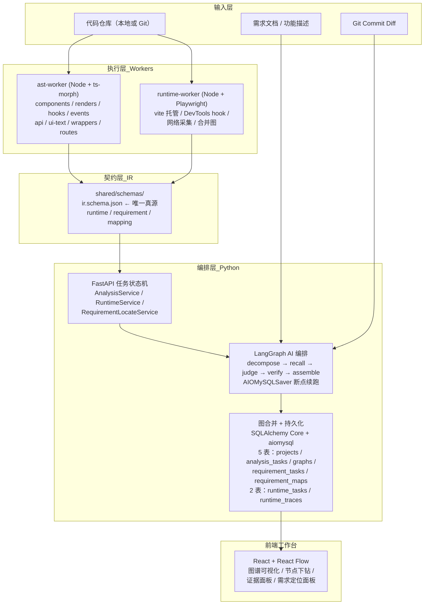

# 前端代码智能分析平台 —— 完整技术方案

> 本文面向技术决策者与后续开发者，**系统回答五个问题**：平台想做什么、选了什么技术、为什么这样选、信息是怎么收集到的、IR 是什么。与 [engineering.md](./engineering.md)（实现硬约束）和 [p3-semantic-layer-design.md](./p3-semantic-layer-design.md)（阶段计划）互补，是最上层的全景文档。

---

## 一、平台想做什么

一句话：

> 输入一份需求文档 / 一段功能描述 / 两个 Git Commit 之间的 Diff，平台结合前端代码仓库，自动定位涉及的**页面、UI 组件、组件属性、事件处理函数、状态管理、接口调用与页面跳转关系**，最终产出一份**可视化、可下钻、带证据链的前端功能链路图**。

三个真实场景对应三种输入模式：

| 场景 | 痛点 | 输入 | 平台输出 |
| --- | --- | --- | --- |
| **接手陌生项目** | 只能靠 `Ctrl+点击` 逐个跳转，无法整体理解页面由哪些组件 / Hook / 接口构成 | 代码仓库（本地目录或 Git URL） | 页面 → 组件 → Hook → API 的完整关系图，可下钻到源码 |
| **改一处不知道影响面** | 组件被谁使用、props 从哪来、接口在哪调用全靠人肉搜索 | 两个 Git Commit 的 Diff | 变更文件 → 受影响组件 → 受影响页面 → 回归测试点 |
| **需求评审前识别测试重点** | 写了需求、改了代码，但没人能说清楚到底影响了哪些 UI 和交互 | 需求文档 + 对应 Diff | 需求功能点 ↔ 代码位置映射 + 可视化链路 + 置信度 |

### 核心立场（三条不能改的设计原则）

1. **静态分析负责确定代码中实际存在的关系，AI 负责理解这些关系的业务含义，Playwright 负责补充实际运行时观察到的行为。**
2. **不编造节点与边。** 静态分析遇到解析不到就记告警，运行时采集不到就跳过，AI 推断永远封顶置信度 0.6。
3. **每条结论必须携带来源、置信度、代码位置。** 禁止输出无法追溯的自由文本结论。

---

## 二、技术选型全景与理由

### 2.1 分层选型表

| 层 | 选型 | 为什么选它 | 为什么不选其他 |
| --- | --- | --- | --- |
| 前端工作台 | React + TypeScript + React Flow | React Flow 是目前最成熟的节点式关系图组件，内置布局、缩放下钻、自定义节点卡片；TypeScript 与后端契约同源生成 | 不用 D3 手写——节点交互、拖拽布局、缩放都是成熟需求，不值得自研 |
| **后端编排** | Python 3.12 + FastAPI | 异步生态成熟（aiomysql / httpx）、LangGraph 原生、与 AI 框架同语言；任务状态机、校验、装配逻辑都是 I/O 密集 | 不用 Node 统一——静态分析 Worker 已经在 Node（ts-morph 必须），但编排层逻辑偏业务与 AI，Python 更顺手；也不用 Go——fastapi 的开发效率对单人项目够用 |
| **静态分析 Worker** | Node.js + ts-morph | **这是整个方案的核心依赖选择**。ts-morph 是 TypeScript Compiler API 的轻封装，可以直接复用项目的 `tsconfig.json`、`paths` 别名、`baseUrl`，做到**和 tsc 编译语义完全一致**的解析 | 不用 Babel / ESLint 解析器——它们是 syntactic 工具，不理解 TS 符号解析（tsconfig.paths、barrel 穿透、类型归属全丢失）；不用独立写一个解析器——TypeScript Compiler API 已经是最完备的 JS/TS 前端语义分析器 |
| **运行时 Worker** | Node.js + Playwright | Playwright 的 trace viewer 已经证明了其采集能力（操作记录 + DOM 快照 + 网络日志）；与 ast-worker 同语言减少跨语言序列化问题；React DevTools hook 只能在 JS 上下文里调用 | 不用 Python Playwright——可行但 React DevTools 注入脚本写起来别扭，且同语言有复用价值 |
| **持久化** | SQLAlchemy 2.0 Core（仅 Core，不用 ORM）+ aiomysql | SQLAlchemy Core 提供足够的 SQL 构造与结果映射但免去 ORM 开销；aiomysql 是纯 Python |  |
| **AI 编排** | LangGraph + AIOMySQLSaver | 多节点图（decompose → recall → judge → verify → assemble）天然适合 LangGraph 的 StateGraph；MySQL checkpointer 让任务可中断续跑 | 不用单轮 prompt + 结构化输出——候选集大时容易截断、无中间状态恢复、成本不可控 |
| **LLM 调用** | OpenAI 兼容协议（httpx + response_format） | 接入行内计算模型 | 不用 LangChain Agent——太重，我们只需要结构化输出和节点间状态传递；不用直接调 SDK——统一协议让换模型只改一个配置项 |
| **跨层契约** | JSON Schema → 代码生成 | `shared/schemas/*.json` 是唯一真源，`datamodel-codegen` 产 Python 类型、`json2ts` 产 TS 类型，禁止手写同名定义 | 不用 Protobuf——schema 迭代频率高，JSON 更直观；不用 OpenAPI——只覆盖 HTTP 边界，Worker 内部协议也要管 |
| **测试** | pytest（后端）+ vitest（Workers / 前端）+ 环境变量门控的集成测试 | pytest fixture 体系对状态机、仓储测试最顺手；vitest 与 Vite / ts-morph / Playwright 同 Node 生态；真实 MySQL / LLM / Playwright 测试用 `APP_*_INTEGRATION` 门控，无对应环境自动跳过 | 不用 Jest——Vite 生态里 vitest 更快；不用强制所有人配完整环境——测试应该开箱即跑，集成测试按需启用 |
| **代码质量** | ruff + mypy（后端）+ tsc strict（Workers / 前端） | ruff 是目前最快的 Python linter 且替代 flake8+isort+black；mypy 对 Protocol 泛型类型检查最严；tsc strict 是 TS 项目标配 | 不用 pylint——太慢；不用 eslint 全家桶——tsc strict 已经覆盖大部分类型问题 |

### 2.2 一个关键架构决策：为什么 Worker 分离

静态分析必须用 Node（ts-morph），运行时采集也用 Node（Playwright + React DevTools hook）。后端编排用 Python。三者之间**严格通过 JSON Schema 交换数据，不做进程内耦合**。

```
┌─────────────────────────────────────────────────────────────┐
│ Python FastAPI 编排层                                       │
│ 任务状态机 · 持久化 · 图合并 · AI 编排 · API                 │
└─────────┬──────────────────────────┬───────────────────────┘
          │ stdin/stdout JSON        │ stdin/stdout JSON
          ▼                          ▼
┌──────────────────┐     ┌──────────────────────────┐
│ ast-worker (Node) │     │ runtime-worker (Node)    │
│ ts-morph          │     │ Playwright               │
│ AST → IRGraph     │     │ DevTools hook → runtime  │
└──────────────────┘     └──────────────────────────┘
          │                          │
          ▼                          ▼
   shared/schemas/ir.schema.json    shared/schemas/runtime.schema.json
```

**不分离的代价**：如果把 ts-morph 放进 Python 子进程调用，tsconfig 解析、paths 别名、barrel 穿透这些依赖 Node 生态的东西会变成噩梦；如果把 Playwright 放进 Python 编排层但 React DevTools 注入脚本仍然要写 JS，跨语言序列化复杂度指数上升。**进程边界反而让每条链路都可以独立测试、独立替换、独立崩溃不拖垮编排层**。

---

## 三、IR 到底是什么

IR（Intermediate Representation，中间表示）是本平台最核心的数据结构。它是**所有分析器、运行时采集、AI 推断层、数据库表、API 响应、前端图渲染之间唯一的共同语言**。

### 3.1 为什么需要 IR

直接让 LLM 读代码、直接让前端从 Playwright trace 里渲染图、直接让后端从 ts-morph AST 里查组件——这些方案在各做各的时都能工作，但一旦要**把不同来源的信息合并、叠加置信度、让前端统一展示**，就会爆炸。IR 做的事情是：

> 把所有来源的前端分析结果，统一成一套「节点 + 边 + 证据」的图结构，不管这个节点是静态分析扫出来的还是运行时采集到的还是 AI 推断出来的。

### 3.2 IR 长什么样

```json
{
  "version": "1.0",
  "analysisId": "ana_abc123",
  "nodes": [
    {
      "id": "src/pages/UserList.tsx#UserList",
      "kind": "component",
      "name": "UserList",
      "file": "src/pages/UserList.tsx",
      "loc": { "line": 15, "col": 3 },
      "attrs": {
        "uiText": ["用户列表", "搜索", "状态"],
        "hooks": ["useEffect", "useState"],
        "props": [
          { "name": "onRefresh", "type": "() => void", "optional": false }
        ]
      },
      "evidence": [
        { "source": "static", "confidence": 1.0, "file": "src/pages/UserList.tsx", "loc": {"line": 15, "col": 3} },
        { "source": "runtime", "confidence": 0.9, "traceId": "trc_xyz789" }
      ]
    }
  ],
  "edges": [
    {
      "id": "src/pages/UserList.tsx#UserList→src/components/Table.tsx#Table:renders",
      "from": "src/pages/UserList.tsx#UserList",
      "to": "src/components/Table.tsx#Table",
      "kind": "renders",
      "evidence": [
        { "source": "static", "confidence": 1.0, "file": "src/pages/UserList.tsx", "loc": {"line": 32, "col": 11} }
      ]
    }
  ],
  "warnings": [
    { "code": "unresolved_import", "severity": "warning", "stage": "static",
      "file": "src/pages/UserList.tsx", "message": "import './styles.css' 解析不到" }
  ]
}
```

### 3.3 受控枚举（NodeKind / EdgeKind）

**NodeKind**：节点类型是受控枚举，新增必须升级 schema 版本。

| 类型 | 说明 | 典型来源 |
| --- | --- | --- |
| `component` | React 组件（页面组件 + UI 组件） | 静态 / 运行时 |
| `element` | JSX 元素（`<div onClick>` 这类带事件的宿主元素） | 静态 |
| `hook` | 自定义或基础 Hook（`useEffect`、`useCustom`） | 静态 |
| `state` | `useState` 产出的状态 | 静态 |
| `fn` | 业务函数（`fetchUsers`、`handleSearch`） | 静态 |
| `api` | 实际的 HTTP 请求（URL + method） | 静态 / 运行时 |
| `route` | 路由路径（`/users`） | 静态 |
| `server-component` / `server-action` | Next.js RSC 专用 | 静态 |

**EdgeKind**：边的类型。

| 类型 | 说明 | 例子 |
| --- | --- | --- |
| `renders` | 组件渲染了子组件 | UserList → Table |
| `calls` | 函数调用了另一个函数 | UserList → fetchUsers |
| `reads` | 组件读了某个状态 | UserList → useState(loading) |
| `writes` | 组件写了某个状态 | UserList → setLoading |
| `requests` | 组件发了 HTTP 请求 | UserList → GET /api/users |
| `uses` | 组件使用了某个 Hook | UserList → useEffect |

### 3.4 证据链机制（Evidence）

每个节点和边都必须携带至少一条 `evidence`，包含：

```json
{
  "source": "static | runtime | ai",
  "confidence": 0.0 ~ 1.0,
  "file": "相对路径（静态证据）",
  "loc": { "line": 15, "col": 3 },
  "traceId": "运行时采集记录 ID（运行时证据）"
}
```

**置信度取值规则**（这是整个方案最核心的设计约束之一）：

| 来源 | 置信度 | 说明 |
| --- | --- | --- |
| 静态分析 | 恒为 1.0 | 这是源码里**确定存在**的结构，不是推断——`<Table />` 就是渲染了 Table，没有任何歧义 |
| 运行时（双证） | 0.9 | 文件路径 + 组件名都对上了静态节点 |
| 运行时（单证） | 0.7 ~ 0.8 | 只对上文件或只对上组件名 |
| AI 推断 | **封顶 0.6** | AI 匹配候选集后给出的映射结论，服务端硬封顶 |

为什么要这样设计？**因为我们不允许 AI 幻觉覆盖代码事实**。如果你看到一个节点 `confidence=0.6 source=ai` 和另一个节点 `confidence=1.0 source=static`，你立刻知道：后者是代码里真的有，前者是 AI 认为的。这让用户可以放心地把平台输出当成代码事实参考，而不是又让一个 LLM 胡说八道。

### 3.5 告警而非静默降级

分析过程中任何失败都进 `IRGraph.warnings`，前端 `WarningsBanner` 按 severity 排序展示。

```json
{
  "code": "parse_error", "severity": "error", "stage": "static",
  "file": "src/broken.tsx", "message": "TS1005: ';' expected"
}
```

**为什么这是硬约束？** 静默降级会让用户以为某个页面没有组件——实际上是这个文件解析失败了。可追溯的告警让平台输出可审阅、可审计。

### 3.6 统一契约生成链路

```
shared/schemas/*.schema.json          # 唯一真源（5 份：ir / runtime / requirement / mapping / plugin）
        │
        ├── datamodel-codegen ──> backend/app/contracts/*.py   # Python 类型
        │
        └── json2ts ───────────> shared/contracts/src/*.ts    # TS 类型
                                        │
                                        └──> workers/* / frontend 通过 @uicodeanalysis/contracts 引用
```

**禁止手写同名类型定义**。改字段、加枚举值、升版本号——第一步永远是改 schema，然后 `npm run gen:contracts` 重新生成两侧代码，跑一次 typecheck 验证没有漂移。

---

## 四、UI 组件 & 逻辑信息是怎么收集到的

这部分是整个平台最硬核的工程实现。分两条独立链路：**静态分析**（ast-worker）和**运行时采集**（runtime-worker），最终汇入统一 IR。

### 4.1 静态分析链路（ast-worker）

#### 4.1.1 底层技术选型：为什么是 ts-morph（不是 Babel / ESLint / acorn）

这是整个平台最核心的技术选型决定。**ts-morph 是 TypeScript Compiler API 的薄封装**，它让我们可以复用项目自带的 `tsconfig.json`，得到和 tsc 编译器**完全一致**的模块解析与类型系统结果。其他所有解析器（Babel、ESLint、acorn、recast）都是 syntactic 工具，只回答"这段代码长什么样"，不回答"这段代码在项目里是什么意思"。

下面用**四个真实代码场景**对比 ts-morph 和其他解析器的区别，每个场景都直接对应 ast-worker 的实现逻辑：

##### 场景 1：tsconfig 路径别名

项目 `tsconfig.json`：

```jsonc
{ "compilerOptions": { "paths": { "@/*": ["src/*"] } } }
```

`src/pages/UserList.tsx`：

```tsx
import { Table } from '@/components/Table';
```

**ts-morph 怎么做**（[resolver.ts](file:///d:/pythonProjects/UiCodeAnaylysis/MyUiCodeAnalysis/workers/ast-worker/src/resolver.ts#L179-L194)）：直接调用 `imp.getModuleSpecifierSourceFile()`——这是 TypeScript Compiler 在内部已经完成模块解析后的结果，返回值就是 `src/components/Table.tsx` 的 SourceFile 对象。**和 `tsc --noEmit` 的报错完全一致**。

**Babel / ESLint / acorn 怎么做**：它们完全不知道 tsconfig 里有 paths。你要么写一个 glob 匹配器自己实现一遍别名解析（要处理 baseUrl、extends、monorepo 多 tsconfig、大小写敏感），要么放弃、只按裸字符串 `@/components/Table` 处理。**自己实现的路径解析器迟早会和 TypeScript 编译器语义分叉**——比如项目后来加了 `extends: './tsconfig.base.json'`，TypeScript 会正确继承 paths，而你手写的 glob 不会。

##### 场景 2：barrel 穿透 + 导出合并

`src/components/index.ts`（barrel）：

```ts
export * from './Table';
export { default as TableCard } from './TableCard';
```

`src/components/Table.tsx`（实际定义）：

```tsx
export function Table({ ... }) { return <div>...</div>; }
export default function TableDefault() { return <Table />; }
```

**ts-morph 怎么做**（[components.ts](file:///d:/pythonProjects/UiCodeAnaylysis/MyUiCodeAnalysis/workers/ast-worker/src/components.ts#L210-L236)）：

```ts
const exported = file.getExportedDeclarations();
for (const [exportName, decls] of exported) {
  for (const decl of decls) {
    if (decl.getSourceFile() !== file) continue;  // 只保留定义在本文件的
    // Table.tsx 会被遍历到两次 exportName（Table 和 default），
    // 但 decl 指向同一个 AST 节点，合并成一个组件 id
  }
}
```

`getExportedDeclarations()` 会自动沿 `export *` 穿透到最终定义位置。`Table.tsx` 里的 `Table` 会同时出现在 `Table.tsx` 和 `index.ts` 的导出表里——但我们只保留 `decl.getSourceFile() === file` 的条目，组件便只在**定义处**产出一次。而 `Table` 的具名导出和 default 导出指向同一个 AST 节点，按定义位置合并后还是一个组件。

**Babel / ESLint / acorn 怎么做**：它们只告诉你这个文件有 `export * from './Table'` 这条语句。你需要自己写一个 barrel 穿透解析器——要处理 re-export、default re-export、re-export as namespace、循环 barrel 引用…… TypeScript Compiler 已经做过的事情，你又重写一遍，而且大概率写错。

##### 场景 3：三态模块解析（internal / external / unresolved）

`src/utils/request.ts`：

```ts
import axios from 'axios';          // 裸包名
import { hook } from './useFetch';  // 相对路径
import { foo } from '@/broken';     // 别名但指向不存在的文件
```

**ts-morph 怎么做**（[resolver.ts](file:///d:/pythonProjects/UiCodeAnaylysis/MyUiCodeAnalysis/workers/ast-worker/src/resolver.ts#L84-L98)）：

```ts
function resolveOne(fromFile, specifier): Resolution {
  const target = findTargetSourceFile(fromFile, specifier);
  if (target) {
    if (isProjectSource(rootPath, target.filePath))
      return { status: "internal", filePath: target.filePath };    // axios 没装 → 不存在这条
    return { status: "external", packageName: specifier };
  }
  return { status: "unresolved", isLocal: isLocalSpecifier(specifier) };
  // './useFetch' 和 '@/broken' 都是 unresolved，但前者是本地相对路径（真实断链），
  // 后者 @/ 是别名前缀（也是本地），axios 是裸包名（环境问题）
}
```

解析不到的两种情况**必须区分**：相对路径/别名前缀解析不到是代码真实缺陷（`unresolved_import` error 告警），裸包名解析不到是依赖没装（`dependency_not_installed` info 告警）。把两者混为一谈会让"依赖没装"淹没"代码写错"。

**Babel / ESLint / acorn 怎么做**：完全做不到三态。它们不知道 `node_modules` 装了什么、`tsconfig` 别名是什么——你只能把所有解析失败的 import 当成同一种情况。

##### 场景 4：组件判定看结构不看名字

普通函数 vs 自定义 Hook vs React 组件：

```tsx
const formatDate = (d) => d.toISOString();              // 普通函数
const useUserData = () => useState(null);                // 自定义 Hook
const UserList = ({ users }) => <List>{users}</List>;   // React 组件
```

**ts-morph 怎么做**（[components.ts](file:///d:/pythonProjects/UiCodeAnaylysis/MyUiCodeAnalysis/workers/ast-worker/src/components.ts#L63-L82)）：

```ts
function looksLikeComponent(node: Node): boolean {
  const hasJsx = node.getDescendants().some(d => JSX_KINDS.has(d.getKind()));
  if (hasJsx) return true;
  const returnTypeText = node.getType().getCallSignatures()
    .map(sig => sig.getReturnType().getText()).join("|");
  return /JSX\.Element|ReactElement/.test(returnTypeText);
}
```

判定依据是**体内有没有 JSX 节点**（不依赖 `@types/react` 是否安装）和**返回类型是不是 JSX.Element**。`formatDate` 里没有 JSX、返回 `string`；`useUserData` 里没有 JSX、返回是 `[T, SetState<T>]` tuple；`UserList` 里有 `<List>` JSX 节点。**零名字推断**——不会因为函数名以 `use` 开头就当 Hook，不会因为大写开头就当组件。

**Babel / ESLint / acorn 怎么做**：它们只能拿到函数体的 AST。用 Babel 遍历器也能找 JSX 节点，但**类型检查完全缺失**——`getType()`、`getCallSignatures()`、`Node.isFunctionDeclaration()` 这些都没有。

##### 对比汇总

| 能力 | ts-morph | Babel | ESLint | acorn |
| --- | :---: | :---: | :---: | :---: |
| 复用 tsconfig paths 别名 | ✅ | ❌ | ❌ | ❌ |
| barrel 自动穿透到最终定义 | ✅ | ❌ | ❌ | ❌ |
| 区分 internal / external / unresolved | ✅ | ❌ | ❌ | ❌ |
| 三态 unresolved（本地断链 vs 依赖未装） | ✅ | ❌ | ❌ | ❌ |
| 类型系统查询（返回类型、泛型参数） | ✅ | ❌ | ❌ | ❌ |
| 符号引用查找（谁引用了这个 useState） | ✅ | ❌ | ❌ | ❌ |
| 项目级 SourceFile 索引 | ✅ | ❌ | ❌ | ❌ |
| 成熟度 | TypeScript 官方 Compiler 的薄封装 | 插件生态丰富 | AST traversal 好 | 最快解析器 |
| 可调试性 | 继承 tsc 的错误信息 | 自实现 parser，错误信息一般 | 自实现 | 自实现 |

**ts-morph 的唯一缺点**：启动慢（首次加载 `ts.Program` 会构建整个项目的类型信息，~90ms/文件）。解决方式是复用——同一个 `Project` 实例在单次分析内复用，后续 `getExportedDeclarations()` 调用就变成 ~1ms/次，复用率提升了约 90 倍。这已经在 ast-worker 里固化为硬约束（见 engineering.md）。

#### 4.1.2 分析器模块清单（每个做什么）

| 模块 | 产出 | 方法 |
| --- | --- | --- |
| **components.ts** | `component` 节点 | 函数体内是否出现 JSX 节点（不依赖 `@types/react` 是否安装）；返回类型是否是 `JSX.Element`；不看函数名（避免把普通函数当组件或把自定义 hook 误判） |
| **paths.ts + resolver.ts** | 模块解析三态 | 消费 ts-morph 的 `getModuleSpecifierSourceFile()`，区分 internal / external / unresolved；自己不实现 paths 匹配 |
| **renders.ts** | `renders` 边 | 遍历 JSX 开标签，排除首字母小写的 DOM 元素（`<div>`），解析点号标签的最后一段（`Antd.Button` → `Button`），按「定义位置键」（file + charOffset）反查目标组件 |
| **props.ts** | 组件节点 `attrs.props` | 可选性只认问号（`a?: T` vs `a: T \| undefined` 是两件事）；类型文本取源码里的类型节点不取类型系统（保留 `UserRowProps[]` 而不展开成 `{ userId: string; ... }[]`）；默认值只能从解构读（类型系统不记录默认值） |
| **hooks.ts** | `hook` / `state` 节点 + `reads` / `writes` 边 | `useState` 单独算 state 节点，其余算 hook；归属只看组件函数体顶层（穿过函数就停，符合 React 规则）；reads/writes 靠符号引用贯穿全部嵌套层级（`setLoading` 写在 effect 里仍然是本组件写自己的状态） |
| **events.ts** | `element` 节点 + `attrs.events` | 只认 `on[A-Z]`（React 语言级约定）；宿主元素（`<div onClick>`）和组件回调 prop（`<RowItem onClick>`）同等对待；内联处理函数下探全部嵌套层级（闭包回调里的 setter 也算） |
| **api.ts** | `api` 节点 + `requests` 边 | HTTP 客户端靠「名字 + 符号来源」双重判定（`fetch` + 声明在项目外才是浏览器 fetch，项目里自己写的 `fetch` 不算）；封装器不产 api 节点（URL 定不下来），只登记参数位置；多层封装器识别做不动点循环；置信度三档（URL 字面量 1.0 → 经封装器 0.9 → 经局部变量 0.8） |
| **ui-text.ts** | 组件节点 `attrs.uiText` | 只认枚举来源（JSX 文本 / 白名单属性 placeholder,title,label / 对象字面量的 title,label / i18n 取词键）；`array` 来源额外收紧（含中文或空格或首字母大写，避免把配置表 `["px","rem","em"]` 灌进来）；组件外常量只记告警不猜归属 |
| **wrappers.ts** | 二次封装语义注解 `attrs.wrapper` | 不新增节点与边——renders 分析器已经产出了 `ProTable → Table` 的渲染边；映射只做语义注解（ProTable 就是 antd.Table 的二次封装，props 怎么改名）；所有映射规则来自项目根目录 `mapping.json`，核心分析器零硬编码 |
| **routes.ts** | `route` 节点 + `renders` 边 | 只认受控 API（`react-router-dom` / `createBrowserRouter([{path,element}])` / `<Route path element>`）；动态 path 记告警不编造；产出 `routeId → 页面组件` 的映射，供需求召回的 `routePath` 信号使用 |

#### 4.1.3 静态分析的几条硬规则（engineering.md 已固化）

1. **节点 id 必须是 `文件路径 + 组件名` 组合**，同一文件多组件不得冲突（`src/Table.tsx#Table` / `src/Table.tsx#Row`）。
2. **不自己实现 paths 匹配**。tsconfig 里写什么，ts-morph 按什么解析，我们只消费结果。
3. **renders 边只连组件，不连宿主元素**。不产 `<div>` 节点，首字母小写的标签按 JSX 编译语义就是 DOM 元素。
4. **同一 (from → to) 只产一条边**。列表里 10 个 `<RowItem />` 是同一个结构事实。
5. **外部组件进图但明确标注不可见**。`antd#Table` 是薄节点，`attrs.external = true`，`confidence = 0.6`，不带 file/loc。它的内部结构不在静态分析范围内——不要为了"图更完整"而编造子节点。

### 4.2 运行时采集链路（runtime-worker）

#### 4.2.1 为什么需要运行时：静态分析的六个盲区

静态分析能回答"代码里写了什么"，但回答不了"浏览器里实际发生了什么"。下面是六个**真实项目里常见、静态分析必然回答错或回答不了**的场景：

##### 盲区 1：代码里有，但运行时根本没执行（Dead Code 伪装成活节点）

```tsx
// src/pages/Dashboard.tsx
export function Dashboard({ user }) {
  return (
    <>
      <UserList />
      {user.isAdmin && <AdminPanel />}
      {process.env.NODE_ENV === 'development' && <DebugToolbar />}
    </>
  );
}
```

静态分析产出三条 renders 边：`Dashboard → UserList`、`Dashboard → AdminPanel`、`Dashboard → DebugToolbar`。但运行时采集会发现：
- 当前用户不是 admin → **AdminPanel 从未被渲染**
- 生产环境 → **DebugToolbar 从未挂载**
- 合并图里这两个节点没有 runtime evidence，前端可以据此标记"未观测到"

静态分析只能看到 JSX 条件表达式，无法判断 `user.isAdmin` 运行时是什么值、`process.env.NODE_ENV` 在构建后是什么。

##### 盲区 2：动态 import + 懒加载组件

```tsx
// src/pages/Home.tsx
const LazyChart = lazy(() => import('./Chart'));

export function Home() {
  return (
    <Suspense fallback={<Loading />}>
      <LazyChart />
    </Suspense>
  );
}
```

静态分析能看到 `import('./Chart')` 这个动态导入语句，但**看不到 Home 组件真的渲染了 Chart**——因为 AST 里 `lazy(() => import('./Chart'))` 是一个函数调用，不是 JSX 开标签。renders 分析器只遍历 JSX 标签，不会去解包 `lazy()` 里的函数体。运行时采集通过 React DevTools hook 看到 fiber 树里确实有 `<Chart>` 节点。

##### 盲区 3：HOC / 条件组件封装导致的名字错位

```tsx
// src/components/EnhancedTable.tsx
export const EnhancedTable = withAuth(withPagination(withSort(Table)));
```

静态分析看到 `EnhancedTable` 是一个变量声明、初始值是函数调用链，但**EnhancedTable 体内没有 JSX**（它是高阶组件链的返回值，不是组件函数定义）。所以静态分析**不会把 EnhancedTable 识别成组件**，漏掉它和 Table 之间的关系。运行时采集通过 fiber 名字 + `_debugSource` 位点可以找到 EnhancedTable，merge 阶段按文件路径 + 名字对齐，追加 runtime evidence。

##### 盲区 4：API 调用链里的运行时参数

```ts
// src/services/api.ts
export function request(url, options) {
  return fetch(`${BASE_URL}${url}`, {
    ...options,
    headers: { 'Authorization': `Bearer ${getToken()}` },
  }).then(r => r.json());
}

// src/components/UserList.tsx
useEffect(() => {
  request(`${API_PREFIX}/users`, { method: 'GET' });
}, []);
```

静态 api 分析器能从字面量看出 `${API_PREFIX}/users`，但**拿不到 `${BASE_URL}` 的值**（它是另一个模块的常量）、**拿不到 `${getToken()}` 的运行时返回值**、**拿不到 fetch 的真实 URL 与 HTTP status**。运行时采集通过 Playwright 的 `page.on('request')` / `page.on('response')` 钩子，拿到**浏览器里实际发出的请求**：完整 URL（`https://api.example.com/v1/users`）、method（GET）、status（200）、耗时（127ms）。

##### 盲区 5：React≥19 fiber 没有 `_debugSource`

React 18 的 fiber 节点有 `_debugSource`（指向 JSX 创建位点：文件 + 行 + 列），可以和静态节点 id 精确对齐。**但 React 19.1 的 fiber 已经移除了 `_debugSource`**——这不是设计选择或配置问题，是 React 19 的内部实现变化。实测的降级链：

| React 版本 | fiber 可用字段 | 我们怎么用 | 匹配置信度 |
| --- | --- | --- | :---: |
| ≤18 | `_debugSource.fileName + lineNumber + columnNumber` | **file + name 双证** | 0.9 |
| ≥19 | `_debugStack`（Error 实例，stack trace 首帧即 JSX 位点） | 解析 stack trace，跳过 node_modules 帧取第一个应用帧 | 0.9 |
| ≥19（无 stack） | `elementType.name` | **仅名字匹配**（项目内重名组件不匹配） | 0.7 |

这个降级链是**实测结论**，不是文档假设。运行时采集器必须同时处理三种情形——静态分析不管这些，但运行时必须面对 React 版本差异。

##### 盲区 6：组件挂载多次（列表渲染、条件渲染）

```tsx
// src/pages/Orders.tsx
export function Orders() {
  return (
    <div>
      {orders.map(order => <OrderRow key={order.id} order={order} />)}
    </div>
  );
}
```

静态分析产出一条 renders 边：`Orders → OrderRow`。但**不知道 Orders 页面挂载了几个 OrderRow**（1 个？10 个？100 个？）、**不知道哪些 OrderRow 被用户点击过**。运行时采集通过 `flatten_component_tree()` 深度优先摊平 fiber 树，**同一组件挂载多次会重复出现**（如实保留），让后端可以统计"这个页面上 OrderRow 被渲染了 N 次"。

#### 4.2.2 runtime-worker 采集链路

采集是一次 Playwright 驱动的浏览器会话（[collect.ts](file:///d:/pythonProjects/UiCodeAnaylysis/MyUiCodeAnalysis/workers/runtime-worker/src/collect.ts)）：

```
启动 vite dev server（strictPort，避免静默换端口；解析端口前先剥 ANSI 粗体码）
  │
  ▼
Playwright newContext（新 context 确保 addInitScript 对后续页面生效）
  │    addInitScript 注入 __RUNTIME_COLLECTOR__
  │    （必须是函数形式；被序列化的函数必须自包含——页面上下文里没有闭包变量）
  ▼
Playwright navigate(页面 URL) → 等待 settleMs（默认 3s，让网络请求落定）
  │
  ▼
React DevTools hook 遍历 fiber root（extract.ts）
  ├── _debugSource（React≤18）→ file + line + col
  ├── _debugStack（React≥19）→ 解析 stack trace，跳过 node_modules 帧取第一个应用帧
  └── elementType.name（兜底 name-only）
  │
  ▼
Playwright page.on('request')/on('response') 记录网络日志
  （用 route.continue() 透传，不拦截、不修改）
  │
  ▼
组装 RuntimeTrace（runtime.schema.json） → stdin/stdout JSON 协议交付后端
```

##### 模块清单

| 模块 | 产出 | 方法 |
| --- | --- | --- |
| **vite-server.ts** | vite dev server 生命周期托管 | 启动目标项目的 vite dev server，解析端口前先剥 ANSI 粗体码（vite 7 用粗体码隔开端口号），strictPort 保证失败显式可见 |
| **install-collector.ts** | React DevTools hook 注入 | 在 Playwright 的 addInitScript 里注入 `__RUNTIME_COLLECTOR__`，遍历 `window.__REACT_DEVTOOLS_GLOBAL_HOOK__`；被序列化的函数必须自包含 |
| **extract.ts** | 组件树采集 | 遍历 fiber root，对每个 fiber 收集文件路径 + 组件名 + props 快照；**React≥19 的降级链**：`_debugSource` → `_debugStack` → `name-only` |
| **collect.ts** | 网络请求记录 | Playwright `page.on('request')` / `page.on('response')`，用 `route.continue()` 透传 |
| **normalize.ts** | 运行时节点 → IR 节点 | 按「文件路径 + 组件名」键对静态图做匹配，命中追加 `evidence.source=runtime`；置信度 file+name 双证 0.9 / 仅 file 0.8 / 仅 name 0.7 |
| **parse-request.ts** | 请求 → api 节点映射 | URL 规范化、method 补全、请求-响应配对 |

#### 4.2.3 合并图：纯函数 + 零副作用（不编造节点与边）

合并逻辑（[merge.py](file:///d:/pythonProjects/UiCodeAnaylysis/MyUiCodeAnalysis/backend/app/runtime/merge.py#L85-L166)）是纯函数，输入 = 静态 IRGraph + RuntimeTrace，输出 = 新的 merged IRGraph；不修改入参、不触碰数据库。

```python
def merge_static_with_runtime(static: IRGraph, trace: RuntimeTrace) -> IRGraph:
    occurrences = flatten_component_tree(trace.componentTree)  # 深度优先摊平 fiber 树
    matched: dict[str, list[Evidence]] = {}

    for component in occurrences:
        # _match_node 按 file + name 键对上静态节点
        # file + name 都对 → 0.9；仅 file 对 → 0.8；仅 name 对（且项目内唯一）→ 0.7
        node, confidence = _match_node(component, static_nodes)
        if node is None:
            # 对不上号 → 盲区 2/3 的组件会落到这里
            warnings.append(Warning(code="runtime_component_unmatched", ...))
            continue
        evidence = Evidence(source=Source.runtime, confidence=confidence, trace_id=trace.traceId)
        matched.setdefault(node.id, []).append(evidence)

    # 重建节点列表：给命中的节点追加 evidence
    merged_nodes = []
    for node in static.nodes:
        extras = matched.get(node.id, [])
        if extras:
            merged_nodes.append(node.model_copy(update={"evidence": [*node.evidence, *extras]}))
        else:
            merged_nodes.append(node)
    return IRGraph(nodes=merged_nodes, ...)
```

**关键约束**：合并只追加 evidence，不新增节点、不新增边。运行时看到了静态图里没有的组件（盲区 2/3 的场景），**只记 `runtime_component_unmatched` info 告警，绝不凭空造节点**。这是和静态分析"告警而非静默降级"的同一立场。

#### 4.2.4 运行时补全在 IR 证据链上的实际效果

##### 合并前（静态图）

```json
{
  "id": "src/pages/Dashboard.tsx#Dashboard",
  "kind": "component",
  "name": "Dashboard",
  "file": "src/pages/Dashboard.tsx",
  "evidence": [
    { "source": "static", "confidence": 1.0,
      "file": "src/pages/Dashboard.tsx", "loc": {"line": 12, "col": 3} }
  ]
}
```

##### 合并后（运行时采集到 Dashboard 页面确实被访问，fiber 位点对上）

```json
{
  "id": "src/pages/Dashboard.tsx#Dashboard",
  "kind": "component",
  "name": "Dashboard",
  "file": "src/pages/Dashboard.tsx",
  "evidence": [
    { "source": "static",  "confidence": 1.0,
      "file": "src/pages/Dashboard.tsx", "loc": {"line": 12, "col": 3} },
    { "source": "runtime", "confidence": 0.9,
      "file": "src/pages/Dashboard.tsx", "loc": {"line": 12, "col": 3},
      "traceId": "trc_abc123def" }
  ]
}
```

同一条 evidence 链上既有 `static 1.0` 又有 `runtime 0.9`，前端可以据此做三种差异化展示：

| 情况 | evidence 链 | 前端含义 |
| --- | --- | --- |
| 双证齐全 | static 1.0 + runtime 0.9 | 代码里有、运行时也观测到 → **已确认** |
| 只有静态 | 仅 static 1.0 | 代码声称有、但这次运行时没观测到 → **可能是 dead code / 懒加载未触发 / 条件渲染未满足** |
| 只有运行时 | runtime 0.9 + `runtime_component_unmatched` 告警 | 运行时看到了、但静态图里找不到 → **可能是动态 import / HOC / 插件注入 / 第三方组件** |

#### 4.2.5 采集模式：被动 + 静默观察

当前是 Playwright A 模式：启动 vite dev server → 等页面加载 → React DevTools hook 抓一次组件树 → 观察窗口内的网络请求 → 停。**不做页面交互、不填表单、不点击按钮**。

Playwright B 模式（AI 自动探索页面、场景与用例生成）作为 P4 预留，需要 AI 层接管 Playwright 的 `page.click` / `page.fill` / `page.screenshot`。

### 4.3 两路信号如何汇入统一 IR

```
静态分析 Worker                    运行时 Worker
    │                                │
    │  IRGraph                       │  RuntimeTrace（runtime.schema.json）
    ▼                                ▼
┌─────────────────────────────────────────────┐
│  合并层（backend/app/runtime/merge.py）      │
│  · 按 file+组件名键对齐静态节点              │
│  · 命中 → 追加 runtime evidence              │
│  · 未命中 → 记 runtime_component_unmatched   │
│  · 纯函数，零 I/O，可单元测试                 │
└─────────────────────────────────────────────┘
    │
    ▼
  IRGraph（kind='merged'）
    │
    ▼
  MySQL runtime_traces 表 + graphs 表覆盖写
    │
    ▼
  前端 React Flow 图谱
  · 节点详情可见静态证据（源码位置）
  · 节点详情可见运行时证据（traceId 反查）
  · 同节点双证据高亮显示
```

---

## 五、AI 语义层（P3 补齐，确定性召回已落地）

AI 层的输入不是"整个代码仓库"，而是"功能点 + 确定性召回的候选集"。

### 5.1 为什么不让 LLM 直接读全仓库

| 方案 | 问题 |
| --- | --- |
| LLM 读全仓库文件 | 上下文窗口不够 → 采样式读取不完备 → 给不出 loc → 结果不可复现 |
| LLM 读全仓库 API | 同样采样问题 + API 端点和代码节点之间没有天然对应 |
| **两阶段（确定性召回 + LLM 精排）** | 召回零 LLM、可复现、可解释；LLM 只看 ≤30 个候选（每个带信号与命中理由），上下文完全可控 |

### 5.2 确定性召回（已实现，无需 LLM）

需求文本 → 词典驱动功能点拆解 → 每个功能点分别在 IR 图上按信号加权召回候选。

六种信号（[requirement.schema.json](../shared/schemas/requirement.schema.json) 定义）：

| 信号 | 匹配对象 | 例子 |
| --- | --- | --- |
| `routePath` | 路由节点的 path | 需求说"用户列表页"，召回 `/users` 路由 |
| `componentName` | 组件节点名 | 需求说"表格"，召回 Table 组件 |
| `uiText` | 组件的可见文案 | 需求说"搜索用户"，召回 attr.uiText 包含该文案的组件 |
| `apiUrl` | api 节点的 URL 路径 | 需求说"用户接口"，召回 `/api/users` |
| `propName` | props 名 | 需求说"表格的列"，召回含 columns prop 的组件 |
| `propDescription` | props 的 JS 文档注释 | 需求说"分页"，召回 prop 描述含 pagination 的组件 |

### 5.3 LangGraph StateGraph（P3 补齐）

```
需求文本
  │
  ▼
decompose（词典拆解 → 功能点 + 检索词）
  │
  ▼
recall（确定性召回 → 候选集，每候选带命中信号）
  │
  ▼
judge（LLM 分批判定 → 每功能点选候选 + 逐字引文 + modelConfidence）
  │
  ▼
verify（服务端校验四道闸：候选集内 / quote 逐字存在 / featureId 有效 / confidence 封顶 0.6）
  │
  ▼
assemble（两跳子图遍历 + 影响面解释 + 回归建议）
  │
  ▼
RequirementMap（requirement.schema.json）
```

- **checkpointer**：AIOMySQLSaver，thread_id = requirement_id，节点失败可从中断处续跑，已完成的召回不重算。
- **四道闸**：这是防止 AI 幻觉的最后防线。被拒的模型输出进 `dropped` 必须展示——审核模型是否在幻想，只能靠这份记录。

### 5.4 推断层与事实层物理隔离

IRGraph 是**事实层**（confidence 恒 1.0，每条 evidence 都是代码或运行时的直接记录）。RequirementMap 是**推断层**（confidence 封顶 0.6，是 AI 把需求映射到代码的结论）。两者物理隔离在不同的 schema 和不同的数据库表里。

**为什么物理隔离？** 如果把 AI 推断混进 IRGraph 的 evidence，那前端看到一个 `confidence=0.6 source=ai` 的节点时会困惑：这是代码里真的有还是 AI 猜的？物理隔离让前端可以放心地把 IRGraph 当成代码事实参考，把 RequirementMap 当成需要人工审核的定位建议。

---

## 六、整体架构图



---

## 七、迭代路线图

| 阶段 | 状态 | 交付 |
| --- | --- | --- |
| **M1 核心静态分析** | ✅ 已完成 | ast-worker 全模块 + 编排层 + 前端工作台 + 内存持久化 |
| **P1 MySQL 持久化** | ✅ 已完成 | SQLAlchemy Core + aiomysql + 5 表 + boot recovery |
| **P2 运行时采集** | ✅ 已完成 | runtime-worker + React DevTools hook + 合并图 merged 类型 |
| **P3 AI 语义层** | 🔶 进行中 | 路由分析器（已实现）+ 判定/校验 + LangGraph + 前端需求定位面板 |
| **P4 Diff 影响分析** | ⬜ 待开始 | base→head 两棵 IR 图集合差 + 反向影响传播 + 回归建议 |
| **P5 Playwright B 模式** | ⬜ 待开始 | AI 自动探索页面、场景与用例生成 |

---

## 八、明确不做的事

1. **不做在线 IDE**，不提供代码编辑能力；代码查看靠跳转编辑器或只读 diff。
2. **不做运行时性能剖析**（React Profiler 的 FPS/重渲染次数不在范围内）——我们关注的是「哪些组件参与了这条功能链路」，而不是「哪个组件渲染最慢」。
3. **不把 AI 推断混成代码事实**。IRGraph 是事实层（confidence 恒 1.0），RequirementMap 是推断层（confidence 封顶 0.6），两者物理隔离。
4. **核心分析器不写任何业务名硬编码**。不出现 `if (tag === 'ProTable')` 这类判断——映射规则全部在项目根目录的 `mapping.json` 或插件清单里。
5. **一期只支持 React + TypeScript / JavaScript**。Vue / Svelte 等通过语言解析适配器扩展，不重写核心分析引擎。
